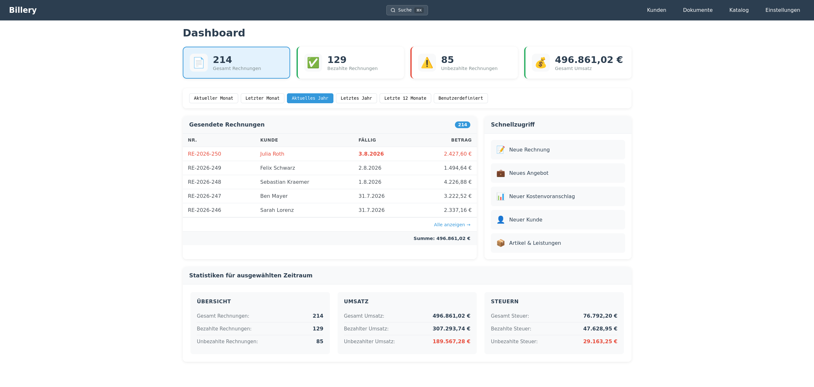

# Billery

[](https://billery-app.github.io/billery/doxygen) [](https://billery-app.github.io/billery/jacoco/) [](https://billery-app.github.io/billery/coverage/) [](https://billery-app.github.io/billery/swagger/)

Self-hosted invoicing application for German freelancers and small businesses. Manages customers, articles, services, and the issuing company, and produces invoices, offers, cost calculations, and final invoices from user-defined templates.



## Features

**Documents**
- Invoices, offers, cost calculations, parted invoices, and final invoices
- GoBD-oriented invoice flow: drafts get their number only when issued, issued invoices are frozen (no edit, no delete), corrections via Stornorechnung with its own number series
- Payment tracking with partial payments and reversals (status derived from payments), audit trail per document
- VAT rate per line (19 % / 7 %), totals per rate; tax treatments Kleinunternehmer (§ 19), reverse charge (§ 13b) and tax-exempt (§ 4) with the required invoice notes
- Status tracking (draft, sent, partially paid, paid, accepted, rejected, cancelled, overdue, converted) with per-type transition rules
- Document number series
- Convert offers and cost calculations to invoices
- Parted invoice series closed by a final invoice

**Contacts and catalog**
- Customer management with address fields
- Article and service catalog with net price, tax rate, and unit
- Owner (issuing company) profile used in templates and exports

**Templates**
- Start gallery with style presets (Modern, Klassisch, Minimal, Leer)
- Simple mode for the whole document: logo, accent color, font, text size, arrangement, optional parts, margins
- Block editor (header, sender / recipient address, document data, line items, totals, payment, notes, footer) with outline, drag and drop, half-width blocks side by side, undo/redo
- Configuration panel per block; variables shown as labelled chips (inserted with `@` or a searchable picker) instead of `{{variable}}` syntax
- Live preview with sample data, the company data or the real document, plus an exact PDF preview from the server
- Validation before saving (required blocks, unknown variables)
- Multiple templates per document type; default templates seeded on first start

**Output**
- PDF export (HTML rendered to PDF/A-3b with embedded fonts)
- ZUGFeRD / Factur-X: the PDF of an issued invoice or Stornorechnung carries the XRechnung (CII syntax) as embedded `xrechnung.xml`; a test compares the XML with the page and with the UBL XRechnung
- XRechnung 3.0 e-invoice (UBL) for issued invoices and Stornorechnungen, built from the data frozen at issue and checked in CI against the official KoSIT validator
- GoBD data export (§ 147 Abs. 6 AO): ZIP with CSV tables, GDPdU `index.xml`, PDFs and XRechnungs; process documentation in `docs/operations/verfahrensdokumentation.md`
- DOCX and ODT import/export (round-trip via the document conversion service)
- File upload endpoint for logos and attachments

**Search and reporting**
- Global search across customers, invoices, articles, and services (Cmd+K / Ctrl+K)
- Invoice statistics (revenue, tax breakdown, status counts)

**Self-hosting and deployment**
- Web stack: Spring Boot 4.1 (Java 25) backend, Vue 3 (Vite) frontend
- PostgreSQL 17 in production, H2 for the self-contained desktop mode
- Docker Compose stack (root) and a database-only Compose file
- Optional Tauri 2 desktop shell (`app-desktop/`) that talks to the backend
- Desktop installers built with Tauri (`scripts/build-desktop.sh`), bundling the backend JAR, a jlink'd JRE and H2
- REST API with Swagger UI at `/swagger-ui.html` and OpenAPI JSON at `/v3/api-docs`

## Quick start

```bash
cp .env.example .env     # optional: ports, DB passwords, bind address
docker compose up --build
```

- App (SPA + API on one origin): `http://localhost:8080`
- Swagger UI: `http://localhost:8080/swagger-ui.html`

The stack brings up PostgreSQL and the backend image, which also serves the built frontend. Self-host mode has no login of its own: it is published on `127.0.0.1` only by default. API writes require a same-origin `Origin` or `Referer`; the backend also sets CSP, nosniff, frame-protection, and HTTPS-only HSTS headers. Behind a TLS proxy, forward the actual `X-Forwarded-Proto` / `-Host` values and keep the backend private. See [`docs/operations/deployment.md`](./docs/operations/deployment.md#behind-a-reverse-proxy) for the browser-auth and proxy requirements. Backend settings are read from environment variables (see `backend/env.example`).

## Local development

**Prerequisites**

- Java 25 (Temurin)
- Maven 3.9+
- Node.js `^20.19.0 || >=22.12.0`
- Docker with Compose v2

**1. Start the database**

```bash
cd backend
docker compose up -d postgres
```

The development-only PostgreSQL listens on `localhost:5432` (`billery` /
`billery123`).

**2. Start the backend** (terminal 1)

```bash
cd backend
SPRING_PROFILES_ACTIVE=dev mvn spring-boot:run
```

Backend runs at `http://localhost:8080`. On first start Flyway creates the schema from `db/migration/V1__baseline.sql` (the hand-rolled idempotent migrations only apply to the H2 desktop database). For demo data put `LOAD_DEMO_DATA=true` into `backend/.env`. Health: `GET /api/health`. Swagger UI: `http://localhost:8080/swagger-ui.html`.

**3. Start the frontend** (terminal 2)

```bash
cd frontend
npm install
npm run dev
```

Vite serves the SPA at `http://localhost:5173`. The API base URL defaults to `http://localhost:8080`; override with `VITE_API_BASE_URL`.

**4. Issue a test invoice**

Open `http://localhost:5173`, fill in the owner profile, add a customer and an article, then create an invoice and export it as PDF.

**Tests, format, and lint**

```bash
# Backend (from backend/)
mvn test                 # run unit tests
mvn spotless:apply       # auto-format (Google Java Format)
mvn spotless:check       # format check
mvn pmd:check            # static analysis
mvn verify               # everything CI runs: tests, coverage, Spotless, PMD

# Frontend (from frontend/)
npm run test:run         # single Vitest run
npm run test:coverage    # Vitest with V8 coverage
npm run test             # Vitest in watch mode
```

There is no `npm run lint` or `npm run typecheck` — the frontend is plain JavaScript.

**Desktop shell (Tauri 2, optional)**

```bash
cd app-desktop
npm install              # one-time, fetches @tauri-apps/cli
npx tauri build          # or: cargo tauri build
```

The Tauri window opens the bundled backend (`http://127.0.0.1:8080`, bound to localhost only), not an embedded SPA build. The `npm run build` and `npm run dev` scripts in `app-desktop/` delegate to the Vue frontend in `../frontend/`, so `tauri.conf.json`'s `beforeBuildCommand` / `beforeDevCommand` work without leaving the desktop dir.

## Documentation

Developer and operator documentation lives in [`docs/`](./docs/):

- [`docs/README.md`](./docs/README.md) — index of the documentation tree
- [`docs/architecture/`](./docs/architecture/) — system architecture (overview, backend, frontend, data model, template system, document pipeline)
- [`docs/guides/`](./docs/guides/) — how-tos: setup, development, testing, conventions, extending
- [`docs/reference/`](./docs/reference/) — lookup: block types, document types, variables, env vars, package index
- [`docs/operations/`](./docs/operations/) — deployment, CI, runtime gotchas

## Security

Please report vulnerabilities privately, see [`SECURITY.md`](./SECURITY.md).

## License

[AGPL-3.0](LICENSE)
