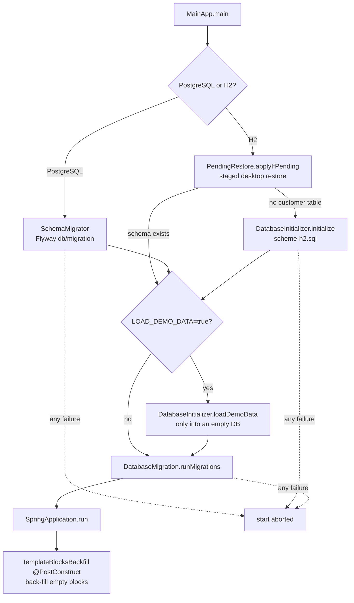

# Backend

> **Status:** chapter 2 of the `docs/architecture/` series.
> **Audience:** contributors and maintainers.
> **Scope:** Spring Boot application structure, package responsibilities, the custom JDBC
> repository pattern, the database lifecycle, configuration, and the two template
> systems that live in the same JVM.
> For the higher-level system view see [`overview.md`](./overview.md). For the
> data model see [`data-model.md`](./data-model.md).

## Module map

Source root: `backend/src/main/java/de/billery/`.

```
api/                   HTTP boundary
  ApiExceptionHandler  maps DatabaseException / TransactionException → 500, MissingConfigurationException → 409
  controller/          one controller per resource (+ DesktopController, desktop profile only)
  dto/                 wire-format objects; no entity leakage
config/
  DbConfig             HikariCP DataSource, JdbcClient, transaction manager, TransactionTemplate
data/                  JDBC plumbing + plain entities (no JPA)
  Database             connection settings; DataSource for the pre-Spring bootstrap
  DatabaseInitializer  runs scheme-h2.sql on first H2 start; demo data on request
  SchemaMigrator       Flyway migrations for PostgreSQL (db/migration/V*.sql)
  DatabaseException    unchecked wrapper thrown by every repository on SQL errors
  DatabaseMigration    hand-rolled, idempotent deltas run on every start
  DatabaseUtils        emptyToNull / nullToEmpty helpers
  *Entity.java         POJOs (Invoice, Customer, Article, Service, Owner, InvoiceTemplate)
repository/            one @Repository per table on JdbcClient, all extend BaseRepository
service/               cross-cutting business logic that doesn't fit a repo or controller
pdf/                   HTML → PDF (Flying Saucer) — block-based + legacy paths
xmlgenerator/          XRechnung XML output (German e-invoice), pure: no database access
tax/                   TaxTreatment, VatCalculator, VatBreakdown — the only VAT computation
mail/                  MailProvider interface, SmtpMailProvider implementation, config
document/              Strategy pattern dispatching on document type
statistics/            reporting aggregations
tenant/                CurrentTenant (the active tenant; self-host is always 1)
desktop/               backups of the desktop app (desktop profile): DesktopBackupService,
                       DesktopBackupController, BackupArchive (ZIP / AES-GCM), PendingRestore
                       (applies a staged restore in MainApp before H2 opens the file)
config/                AppConfig, CorsConfig, SpaWebConfig, WebConfig
MainApp.java           entry point
```

The package layout is mostly a clean four-layer split — controller, service,
repository, data — with a few cross-cutting packages for I/O heavy work (PDF,
XML, mail, document dispatch, statistics).

## Application entry point

`MainApp.main` calls `MainApp.prepareDatabase()` **before** Spring starts:

1. **Bring the schema up to date.** On PostgreSQL, `SchemaMigrator` runs
   Flyway: an empty database gets `V1__baseline.sql` and every later
   `V<n>__*.sql`, a database that has tables but no Flyway history is
   baselined at version 1. The whole run holds a PostgreSQL advisory lock of
   `SchemaMigrator`'s own, so several instances starting at once migrate one
   after the other (Flyway's baseline step runs before its own lock and
   would race). On H2 the `customer` table is checked and, if
   missing, `scheme-h2.sql` runs. A failing *connection* is an error with its
   own message, not a reason to create the schema.
2. **Load demo data** only when `LOAD_DEMO_DATA=true`
   (`DatabaseInitializer.loadDemoData`), and only into a database without
   customers.
3. **Run the H2 migrations** via `DatabaseMigration.runMigrations()` — **on
   H2 only** (desktop installs that predate the current schema); on
   PostgreSQL the call is skipped with a log line. Every migration checks
   whether it is still needed (see [`data-model.md`](./data-model.md)).

Any failure in these steps aborts the start with the cause in the log; the
API never comes up on a missing or half-migrated schema.
`MainAppDatabaseTest` runs this sequence twice against an H2 file database,
`PostgresStartupTest` against a real PostgreSQL.

After bootstrap, `SpringApplication.run` brings up the standard Spring Boot
context. There is no separate `ApplicationContext` configuration class —
controllers, services, and the `TemplateBlocksBackfill` are picked up
via `@SpringBootApplication`'s component scan from the
`de.billery` package and below.

`application.properties` (in `src/main/resources/`) is minimal:

```properties
spring.application.name=billery
server.port=8080
server.forward-headers-strategy=framework
cors.allowed-origins=${CORS_ALLOWED_ORIGINS:}
spring.servlet.multipart.max-file-size=2MB
spring.servlet.multipart.max-request-size=2MB
spring.main.web-application-type=servlet
```

`application-desktop.properties` exists alongside it for the Tauri
desktop mode. The web build uses the default profile.

## HTTP layer

### Controllers

`api/controller/` contains ten controllers, one per resource family. They are
all annotated `@RestController` and `@RequestMapping("/api/<resource>")`.
CORS is handled centrally by `CorsConfig`; controllers carry no
`@CrossOrigin`. Uncaught `DatabaseException` / `MissingConfigurationException`
are turned into JSON errors by `api/ApiExceptionHandler`.

| Controller | Path | Responsibility |
|------------|------|----------------|
| `ArticleController` | `/api/articles` | Article (product) catalog. |
| `CustomerController` | `/api/customers` | Customer CRUD; `/page?page&size&q&sort` (`CustomerPageDto`) pages and searches in SQL (first/last name, "first last", street, city, postal code, phone, e-mail; `sort=id` for the list, `name` for the picker; size 1–200, page 0–10 000, else 400). The unpaged `GET` stays for API compatibility; the SPA does not use it. |
| `DocumentController` | `/api/documents` | Template import/export (DOCX/ODT), variable list and validation. |
| `FileUploadController` | `/api/upload` | Generic file upload (multipart, 2 MB cap). |
| `HealthController` | `/api/health` | Liveness probe. |
| `ExportController` | `/api/export` | `GET /gobd?from&to&documents` — GoBD data export as ZIP. |
| `InvoiceController` | `/api/invoices` | Document CRUD (drafts only for invoices), the paged and filtered document list `/page`, status changes, `/{id}/cancel`, `/{id}/payments` (+ `/{paymentId}/reverse`), `/{id}/history`, `/{id}/xrechnung` (+ `/check`), number preview, PDF download. |
| `InvoiceTemplateController` | `/api/templates` | Template CRUD; the block JSON is stored in the `blocks` column. |
| `OwnerController` | `/api/owners` | Company / owner data (single record). |
| `SearchController` | `/api/search` | Global search across customers, invoices, articles, services. |
| `ServiceController` | `/api/services` | Service catalog. |

`InvoiceController` is the largest by far because it owns the document-number
generation (`/next-number`), the per-customer listing (`/by-customer/{id}`), the
archive toggle (`?includeArchived=...`), and the conversion of `Invoice` →
`InvoiceDto`.

### DTOs

`api/dto/` is the wire format. There is one DTO per resource plus a few
supporting types:

- `ArticleDto`, `CustomerDto`, `InvoiceDto`, `InvoiceItemDto`, `OwnerDto`,
  `ServiceDto`, `InvoiceTemplateDto` — the per-resource shapes.
- `SearchResult` — a composite type with nested customer / invoice / article /
  service result lists.

DTOs are plain records / classes. Mapping between entity and DTO happens in
the controller (`convertToDto` / `convertToEntity` helpers in
`InvoiceController.java`, for example). There is no MapStruct; the mapping is
hand-written to keep the dependency surface small.

## Data access: `JdbcClient` repositories

The project does **not** use Spring Data, JPA or Hibernate. There is no
`EntityManager`, no `@Entity` annotations, no first-level cache. Every
repository writes its own SQL on Spring's `JdbcClient` (named parameters,
`RowMapper` constants).

### `DbConfig` and `Database` — DataSource and transactions

`config/DbConfig.java` defines the beans everything shares:

- a `HikariDataSource` (connection pool). The URL comes from `DB_URL` when
  set (used as-is), otherwise from `DB_HOST`/`DB_PORT`/`DB_NAME`; `DB_USER`
  and `DB_PASSWORD` are then set separately, so the password is never part
  of the logged URL. `Database` resolves these settings; `DbConfig` reads
  them from it.
- the `JdbcClient` the repositories get by constructor,
- a `DataSourceTransactionManager` (built by `DbConfig.newTransactionManager`,
  which the tests reuse) and the `TransactionTemplate` services use.

`data/Database.java` is what is left of the old connection factory: it holds
the connection settings and serves `getConnection()` to the code that runs
**before** Spring starts (`MainApp.prepareDatabase()` → `DatabaseInitializer`,
`DatabaseMigration`), on a `DriverManagerDataSource`. Once `DbConfig` has
built the pool it calls `Database.useDataSource(pool)`, so both paths use the
same database.

Multi-statement writes run in `transactions.execute(status -> ...)`. Every
`JdbcClient` call made inside joins the transaction; nested calls join the
outer one, and a nested failure that the caller handles does not mark the
outer transaction rollback-only. `@Transactional` is deliberately not used:
the unit tests run without a Spring context, where the annotation would do
nothing. Inside a transaction `Database.getConnection()` returns the bound
connection wrapped so that `close`, `commit`, `rollback` and
`setAutoCommit` are no-ops.

### `BaseRepository` — error handling and row helpers

`repository/BaseRepository.java` gives repositories:

- `run(operation, () -> ...)`: runs a `JdbcClient` call and turns Spring's
  `DataAccessException` into a logged, unchecked `DatabaseException`;
- `databaseError(operation, e)`: the same for plain-JDBC code;
- `generatedId(keyHolder)`: the generated primary key after an insert
  (PostgreSQL and H2 may return further generated columns, so the `id`
  column is preferred);
- `decimalOrZero(rs, column)`: a `DECIMAL` column as `BigDecimal`, SQL
  `NULL` as `0`.

The pattern in every repository is:

```java
public Customer findById(int id) {
  return run(
      "findById customer",
      () ->
          jdbc.sql("SELECT * FROM customer WHERE id = :id")
              .param("id", id)
              .query(CUSTOMER_MAPPER)
              .optional()
              .orElse(null));
}
```

`null` from a `findById` means "not found", never "failed".
`api/ApiExceptionHandler` maps `DatabaseException` and a failed commit
(`TransactionException`) to HTTP 500 and
`pdf/MissingConfigurationException` (no owner / no usable template) to 409,
all with a JSON body `{"message": "..."}` that the SPA displays.

### Per-entity repositories

| Repository | Notable methods |
|------------|-----------------|
| `ArticleRepository` | CRUD + search; stores the internal `note` (never printed). |
| `CustomerRepository` | CRUD + search result mapping (`SearchCustomer`). |
| `DocumentNumberSeriesRepository` | `getNextNumber(typeId, year)` reserves a number with an atomic `UPDATE ... last_number + 1` and reads it back in one transaction (joining the caller's, so a failed save releases it); `getLastNumber` backs the preview at `/api/invoices/next-number`. |
| `InvoiceRepository` | CRUD + line items + `findItemsByInvoiceId`; `issue` (number + SENT, guarded by `WHERE status = DRAFT`), `updateStatus(id, status, paidDate)`, `findCreditNoteFor`. |
| `PaymentRepository` | Append-only: `save`, `findByInvoiceId`, `sumByInvoiceId`, `isReversed`. No update / delete on purpose. |
| `DocumentHistoryRepository` | `log(invoiceId, action, notes)`, `findByInvoiceId`; `deleteDraftHistory` only for drafts being deleted. |
| `InvoiceTemplateRepository` | CRUD + `findByDocumentTypeId` + `findDefault(...)`. |
| `OwnerRepository` | CRUD. Owner is logically a singleton but stored as a regular row. |
| `ServiceRepository` | CRUD + optional `article_id` FK lookup. |
| `EquipmentRepository` | CRUD for equipment whose cost is spread over services; `findUsageTotals()` (revenue and usage count of every piece of equipment in one grouped query, for `GET /api/equipment/summary`) and `findUsage(id)` (the lines behind it, one joined query). Both count only service lines on fully paid invoices (status 6). |
| `UserSettingsRepository` | `key/value` table for per-user settings (e.g. document number prefixes); `updateSetting` upserts with `INSERT ... ON DUPLICATE KEY UPDATE`. |

Two important rules:

- **Transactions are opened by the caller, not the repository** (the one
  exception is `DocumentNumberSeriesRepository.getNextNumber`, which joins an
  open transaction). Multi-statement writes (e.g. invoice + line items +
  number + snapshot in `DocumentService`) wrap their work in the injected
  `TransactionTemplate`.
- **Schema migrations are not generated from entities.** The schema lives in
  `V1__baseline.sql` / `scheme-h2.sql` and the migration deltas in
  `DatabaseMigration.java`. Don't expect a missing column to surface as a
  compile error.
- **Everything is constructor-injected.** Repositories, services, the PDF
  generator and `DocumentStrategyRegistry` are Spring beans; controllers and
  services receive them by constructor and never call `new` on them. Tests
  build the same graph by hand through `TestWiring`.

### Service layer

`service/` is small and exists for things that don't naturally fit in a
controller or a repository:

| Service | Job |
|---------|-----|
| `DocumentConversionService` | DOCX/ODT ⇄ HTML conversion (used by `DocumentController`). |
| `DocumentNumberService` | Allocates the next document number for a given type/year via `DocumentNumberSeriesRepository`. |
| `DocumentService` | Create / update / clone. Invoice types only as drafts without number; issued invoices and credit notes throw `DocumentStateException` (409). |
| `InvoiceLifecycleService` | Issue (incl. tax-treatment checks and freezing `party_snapshot`), record / reverse payments, cancel via credit note, delete drafts — see [data-model.md > Invoice lifecycle](./data-model.md#invoice-lifecycle-gobd). |
| `EInvoiceService` | XRechnung of an issued document from its frozen parties; lists missing master data. |
| `GobdExportService` | GoBD data export (§147 Abs. 6 AO): ZIP with CSV tables, GDPdU `index.xml` (`GobdIndex`), PDFs and XRechnungs. |
| `FileSecurityService` | Path-traversal guard for file downloads. |
| `TemplateBlocksBackfill` | `@PostConstruct` — see below. |

### `TemplateBlocksBackfill`

`TemplateBlocksBackfill` runs after the Spring context starts (`@PostConstruct`, not in the
SaaS profile). Templates themselves come only from the SQL seeds (`V1__baseline.sql`,
`scheme-h2.sql`, both with block JSON) and from the editor. The service writes the default
layout (`getDefaultBlocksJson(documentTypeId)`) into every template whose `blocks` value is
`null`, empty, `[]` or `"null"`: that is what the DOCX/ODT import stores, and the PDF path
refuses a template without blocks. The `html_content` and `css_content` columns are kept for
the import / export path.

## Document strategy dispatch

The `document/` package implements a small **Strategy** registry for
status transitions per document type. There is no Spring DI magic — it's a
plain `HashMap<Integer, DocumentTypeStrategy>` populated in the constructor:

| Strategy | `documentTypeId` | What it covers |
|----------|------------------|----------------|
| `InvoiceStrategy` | 1 | Regular invoice. |
| `OfferStrategy` | 2 | Offer / quote. |
| `CostCalculationStrategy` | 3 | Cost calculation. |
| `PartedInvoiceStrategy` | 4 | Parted invoice (advance payments). |
| `FinalInvoiceStrategy` | 5 | Final invoice (closing a parted series). |
| `CreditNoteStrategy` | 6 | Stornorechnung; created issued, no transitions. |

`DocumentStrategyRegistry.getStrategy(id)` returns the strategy for the type
or falls back to the invoice strategy (id 1) for unknown types. Strategies
define which status changes a client may request (e.g. `DRAFT → SENT`,
`SENT → PAID`, `SENT → CANCELLED`); `InvoiceController.updateInvoiceStatus`
consults the strategy and, for invoice types, runs the matching
`InvoiceLifecycleService` step. Ids are named in `DocumentStatus` and
`DocumentType`.

`DocumentTypeStrategy` is the interface; `BaseDocumentTypeStrategy` carries
the common transition table logic.

## Database lifecycle



> **Warning:** `migratePaidToPaidDate` is a v1 → v2 migration that recreates
> the `invoice` table with only the v1 columns. It only fires when an old
> `paid` column exists and no `paid_date` column exists, so on a fresh
> install it is a no-op.

**PostgreSQL uses Flyway.** A schema change is a new file
`src/main/resources/db/migration/V<next>__short_description.sql`; an applied
migration is never edited (Flyway verifies its checksum on every start and
refuses to start otherwise). **H2 (desktop) keeps the hand-rolled
`DatabaseMigration`:** every migration runs on every start and must detect for
itself whether it is still needed. Follow these rules when adding an H2
migration:

1. Prefer `ALTER TABLE ... ADD COLUMN IF NOT EXISTS`, as in
   `migrateAddOwnerUrlAndIban`.
2. When you need metadata, use the helpers: `table(metaData, "invoice")`
   returns the name in the database's identifier case (H2 stores upper
   case) and `constraintExists(conn, name)` is case-insensitive. A lookup
   with the wrong case silently "misses" and the migration then fails on
   every start.
3. Never iterate a `ResultSet` while executing statements on the same
   `Statement`; collect first, then execute.
4. New tables and columns also go into both `scheme-h2.sql` files so fresh
   H2 installs get them directly; the PostgreSQL side is the Flyway
   migration.

## Configuration

### `AppConfig` and `java-dotenv`

`config/AppConfig.java` reads settings from the process environment or, if
unset there, from an optional `.env` in the working directory
(`AppConfig.get(key)`). It defines one path:

| Constant | Default | Purpose |
|----------|---------|---------|
| `FILES_PATH` | `./uploads` | Upload directory, written by `FileUploadController` and served under `/uploads/**` by `WebConfig`. |

`LOAD_DEMO_DATA` is read through `AppConfig.get` as well. Database settings
are read by `Database` directly from the process environment.

### CORS, static resources, and SPA fallback

- `config/CorsConfig.java` registers the only CORS mapping, for `/api/**`,
  with origins from `cors.allowed-origins` (env: `CORS_ALLOWED_ORIGINS`,
  default empty = no CORS mapping, same origin only). Methods include
  `PATCH` (invoice status); no credentials. Controllers carry no
  `@CrossOrigin`.
- `server.forward-headers-strategy=framework` (`application.properties`)
  makes the app honour the reverse proxy's `X-Forwarded-*` headers.
  Without it a same-origin request behind a TLS-terminating proxy
  (`Origin: https://…`, seen as `http://…`) is answered 403 "Invalid CORS
  request", and `FileUploadController` returns `http://` logo URLs. Only
  safe when the backend is reachable through the proxy alone.
- `config/WebConfig.java` serves `/uploads/**` from `FILES_PATH`.
- `config/SpaWebConfig.java` makes the Spring app also serve the built
  frontend from `classpath:/static/`, with a `PathResourceResolver` that
  falls back to `index.html` for any path that is neither under `/api` nor
  under `/assets` and doesn't match a static file. `index.html` (and `/`,
  forwarded to it) is sent with `Cache-Control: no-cache`; the content-hashed
  files under `/assets` are cacheable for a year, and a missing one answers
  404 instead of HTML, so a browser holding an old start page after a
  deployment cannot run HTML as JavaScript (a white page). This is what lets the backend host the SPA when the
  frontend is built into `backend/src/main/resources/static/`.

This is the reason the project ships without a separate static host: the
Spring Boot fat JAR can serve the SPA directly. The Docker Compose setup
still runs them as separate services for development convenience (Vite
HMR), but in a single-binary deploy the backend can host everything.

### File uploads

`spring.servlet.multipart.max-file-size` and
`spring.servlet.multipart.max-request-size` are both 2 MB. The
`FileUploadController` (mapped to `/api/upload`) is the only consumer;
anything larger is rejected by the servlet container before it hits
application code. If you need bigger files, raise these in
`application.properties` and the corresponding limits in any reverse
proxy in front.

Files are stored and read through `storage.FileStorage` (`save`, and `read`,
which returns the bytes of a stored file of the active tenant or `null`):
`LocalFileStorage` (one flat directory, `FILES_PATH`) in self-host and desktop,
`saas.storage.TenantFileStorage` in the SaaS profile, which keeps the bytes in a
directory or an S3-compatible bucket (`BILLERY_FILES_STORE`). The PDF renderer
(`RestrictedUserAgent`, `logoSizeStyle`) reads logos only through `read`.

## Logging

Application code uses `java.util.logging`
(`Logger.getLogger(ClassName.class.getName())`). Once the Spring context
starts, Spring Boot installs the `jul-to-slf4j` bridge, so these logs go
through Logback (`src/main/resources/logback.xml`: console plus
`logs/billery.log`). Log lines written by
`MainApp.prepareDatabase()`, before Spring starts, go to the JUL console
handler only. Do not log customer or owner personal data at `INFO`; the PDF
renderer logs at `FINE`.

## Conventions (backend-specific)

These are the conventions to follow when adding code. The high-level
tooling is enforced by Spotless + PMD (`mvn spotless:check`, `mvn pmd:check`)
— see `AGENTS.md` for the commands.

- **Google Java Format.** Indentation is 2 spaces, line length is 100
  characters. Don't fight the formatter.
- **Static fields named with `CONSTANT_CASE`.**
- **Never swallow a database error:** wrap `JdbcClient` calls in `run("op", ...)`; plain JDBC uses `throw databaseError("op", e)`.
- **Multi-statement writes go through the injected `TransactionTemplate`** (not `@Transactional`).
- **No per-row queries in list endpoints.** The document page and `/by-customer/{id}` build their DTOs through `InvoiceController.convertAllToDto`, which loads customers, items (`findItemsGroupedByInvoiceIds` / `ForCustomer`), payment sums (`sumsByInvoice`) and credit notes (`findCreditNoteIdsByCancelledInvoice`) in one query each. The per-document variant took ~450 ms for the 1 420 demo documents, the batched one ~35 ms. `DocumentLifecycleTest.listEndpointsReturnTheSameDtosAsTheSingleDocumentEndpoint` keeps both paths identical.
- **The document list is paged on the server.** `GET /api/invoices/page?page&size&types&archived&includeArchived&year&from&to&q&status` (`InvoicePageDto`: `items`, `page`, `size`, `total`, `years`) filters and orders in SQL (`InvoiceListQuery`, `InvoiceRepository.findPage` / `count` / `findYears`): tab types, active/archive, year of the document date, case-insensitive search in the number and the customer's "first last" (`%` / `_` literal), the status keys of the SPA's filter including the derived `overdue` and `expired` and the dashboard's `open` (sent or partly paid) / `issued` (sent, partly paid or paid); for the dashboard also an inclusive date range `from`/`to` and `includeArchived` (active and archived together). The order is drafts without number first, then number descending, then id descending, the same on H2 and PostgreSQL. `size` is 1–200 (default 50), `page` 0–10 000 (so the offset stays bounded and cannot overflow; a page past the end is empty), `year` 1–9999 (beyond it `LocalDate` would throw); anything outside, or an unknown status key, answers 400. The page's DTOs come from `convertPageToDto`, whose queries are restricted to the page's documents and customers (`findItemsGroupedByInvoiceIds`, `sumsByInvoiceIds`, `findCreditNoteIdsForInvoices`, `CustomerRepository.findByIds`), so the cost depends on the page size. `InvoicePageTest` checks every filter, paging without overlap and that page items equal the single-document DTO. The SPA no longer calls the unpaged `GET /api/invoices` and `/archived`; they remain for API compatibility. The dashboard uses this endpoint (first five rows) plus `GET /api/invoices/statistics`, whose `InvoiceStatisticsService` loads only the period's documents, credit notes, items and articles, one query each.
- **No `isLoggable` guards needed** (PMD's `GuardLogStatement` is disabled);
  use `LOGGER.fine(() -> ...)` for messages that are expensive to build.
- **DTOs are the wire format** for new endpoints. (`CustomerController` and
  `OwnerController` still return entities.)
- **Money:** `BigDecimal` only, never `double`. The server computes line
  totals (round(quantity) × round(unit price), half-up to cents,
  `InvoiceItem.lineTotal`); never trust a client-sent total.

**Next:** [`frontend.md`](./frontend.md) — the Vue 3 app, the editor
subsystem, and the two variable registries.
