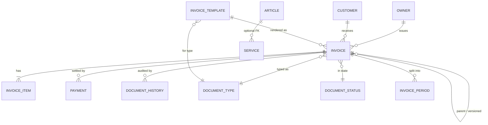
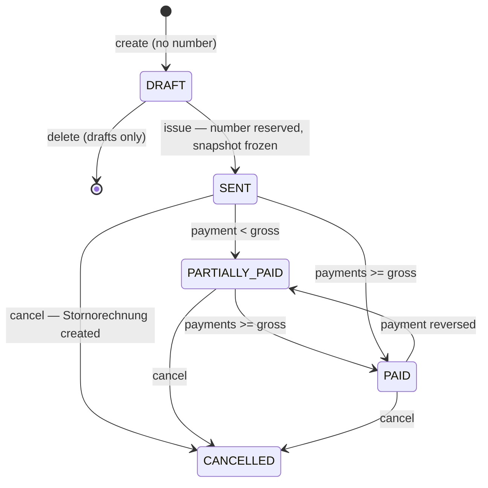

# Data Model

> **Status:** chapter 4 of the `docs/architecture/` series.
> **Audience:** contributors and maintainers.
> **Scope:** entities, schema, relationships, the dual environment (PostgreSQL
> server / H2 desktop and default tests), the custom migration system, and the quirks of the
> v1 → v2 evolution.
> For the higher-level system view see [`overview.md`](./overview.md). For
> the runtime that consumes this schema see [`backend.md`](./backend.md).

## Parallel schemas

The PostgreSQL schema lives in Flyway migrations; the two H2 schemas are
scripts kept in sync by hand:

| File | Driver | Used by |
|------|--------|---------|
| `backend/src/main/resources/db/migration/V1__baseline.sql` (+ later `V<n>__*.sql`) | PostgreSQL 17, applied by Flyway (`SchemaMigrator`) | Production, Docker, dev with the `postgres` service. Also the schema for the whole suite when `POSTGRES_TEST_URL` is set. |
| `backend/src/main/resources/scheme-h2.sql` | H2 in MariaDB mode (`jdbc:h2:mem:testdb;MODE=MariaDB`) | The `desktop` / standalone Spring profile (`spring.profiles.active=desktop`) — not the normal "production" path. |
| `backend/src/test/resources/scheme-h2.sql` | H2 in MariaDB mode | All unit / integration tests. The test classpath shadows the main `scheme-h2.sql`. |

`MainApp.prepareDatabase` runs Flyway (PostgreSQL) or `scheme-h2.sql` (H2)
by inspecting the JDBC URL prefix. The two `scheme-h2.sql` files are
nearly identical but differ in the default-template names (English
`Default Invoice` vs German `Standardrechnung`) — a footgun if a
contributor edits only one of them. The desktop file also adds
`"dateFormat":"DD.MM.YYYY"` to the meta block config and
`"columns":1` to the footer block config; the test file omits both.
Tests use `TestDatabaseConfig` (in
`src/test/java/de/billery/data/`) which sets up H2 in
memory, loads the test `scheme-h2.sql`, and resets the connection
between tests; `TestWiring` builds the repositories on a `JdbcClient`
over that database.

There are no Docker init copies of the schema: both compose files start
PostgreSQL empty and the backend migrates it on its first start. An applied
Flyway migration is **immutable** (Flyway verifies its checksum on every
start): a change is a new `V<n>__*.sql`, never an edit of an old file.

**Quirk to know:** the H2 scripts are written in MariaDB mode and differ
from the PostgreSQL schema. Recurring sources of friction:

- `ALTER TABLE ... ADD FOREIGN KEY` after the table is created works
  on both, but H2 is stricter about the ordering of `CREATE TABLE` and
  `ALTER TABLE` for circular references (e.g. `invoice.period_id` ↔
  `invoice_period.parent_invoice_id`).
- PostgreSQL has no `ENUM` here: `invoice_template.template_format` is a
  `VARCHAR(10)` with a `CHECK` list. Flags are `SMALLINT` (0/1), ids are
  `GENERATED BY DEFAULT AS IDENTITY` (explicit ids in the demo data are
  followed by a `setval`), and `updated_at` on `equipment`,
  `invoice_template` and `user_settings` is kept by the trigger function
  `set_updated_at()` instead of `ON UPDATE CURRENT_TIMESTAMP`.
- Entities and DTOs carry dates as ISO strings (`yyyy-MM-dd`, the JSON
  format), but the repositories bind them to `DATE` columns as typed
  `LocalDate` (`BaseRepository.dateOrNull`: empty means `NULL`, anything
  that is not an ISO date throws). PostgreSQL rejects `varchar` parameters
  for `DATE` columns. Search casts use `CAST(x AS VARCHAR(n))`, never
  `CAST(x AS CHAR)` (one character in PostgreSQL).

When you add a new table or column, add it to **all** the scripts above
(for H2, both copies). The asymmetry is the single most common cause
of "works on my machine, fails in CI".

## Tenant column (PostgreSQL, `V2__tenant_id.sql`)

Every tenant-owned table has `tenant_id INT NOT NULL DEFAULT 1`; the lookup
tables `document_type` and `document_status` are global. Self-host and desktop
installs are "one tenant with id 1": the repositories never mention
`tenant_id`, inserts take the default, and H2 has no such column. The SaaS
profile (see [`multi-tenancy.md`](./multi-tenancy.md)) adds row-level security
on top. What the core schema already guarantees:

- **Uniqueness per tenant:** `document_number_series (tenant_id,
  document_type_id, doc_year)`, `user_settings (tenant_id, setting_key)` as the
  primary key, `invoice (tenant_id, document_number)` and one `owner` per
  tenant. Two companies can therefore both issue `RE-2026-001`.
- **Foreign keys carry the tenant:** every reference is
  `FOREIGN KEY (tenant_id, x_id) REFERENCES parent (tenant_id, id)` (the parents
  have `UNIQUE (tenant_id, id)`). PostgreSQL checks foreign keys without
  row-level security, so a plain `REFERENCES customer(id)` would let one tenant
  attach an invoice to another tenant's customer id and learn from the outcome
  whether that id exists. `ON DELETE` rules are unchanged; the `SET NULL` ones
  name their column (`ON DELETE SET NULL (article_id)`), which needs
  **PostgreSQL 15 or newer**.
- **Upserts name the new keys:** `ON CONFLICT (tenant_id, setting_key)` and
  `ON CONFLICT (tenant_id, document_type_id, doc_year)` (the demo data and test
  fixtures); an `ON CONFLICT` on the old columns no longer matches an index.

`tenant.CurrentTenant` is the interface for code that has to name the tenant
(`DefaultCurrentTenant` returns 1; the SaaS profile replaces it).

## Entity overview



| Entity | Table | Notes |
|--------|-------|-------|
| `Owner` | `owner` | Logical singleton. The issuing company. |
| `Customer` | `customer` | Self-explanatory. |
| `Article` | `article` | Product / rental item. `note` is an internal remark (stored, never printed). |
| `Service` | `service` | Service entry, optionally linked to an article. |
| `Invoice` | `invoice` | The document header. Holds versioning, type, status, totals. |
| `InvoiceItem` | `invoice_item` | Line items (`item_type` is `ARTICLE`, `SERVICE`, or `CUSTOM`). Sub-items are stored via the self-referencing `parent_item_id` column (see [Sub-items](#sub-items-line-item-tree)). |
| `InvoiceTemplate` | `invoice_template` | Block JSON + legacy HTML + CSS + margins. |
| `InvoicePeriod` | `invoice_period` | For "parted invoice" (Teilrechnung) series. |
| `Payment` | `payment` | Append-only payment record against an invoice; reversals are negative rows with `reverses_payment_id`. See [Invoice lifecycle](#invoice-lifecycle-gobd). |
| `DocumentHistoryEntry` | `document_history` | Audit log (action, date, notes, actor id and, filled in by the controller through `ActorNames`, the actor's name), written by `DocumentHistoryRepository`. |
| `DocumentNumberSeries` | `document_number_series` | `last_number` per `(document_type_id, year)`. |
| `DocumentType` / `DocumentStatus` | `document_type` / `document_status` | Lookup tables, seeded with fixed IDs. |
| `UserSettings` | `user_settings` | Key-value table for per-user settings. |

`V1__baseline.sql` and `V1__baseline.sql` seed the `document_type` and
`document_status` lookup rows with the IDs the code depends on:

```text
document_type:     1=INVOICE  2=OFFER  3=COST_CALCULATION  4=PARTED_INVOICE  5=FINAL_INVOICE  6=CREDIT_NOTE
document_status:   1=DRAFT  2=SENT  3=ACCEPTED  4=REJECTED  5=CONVERTED  6=PAID  8=CANCELLED  9=PARTIALLY_PAID

Note: id=7 was formerly `OVERDUE`. It has been removed; an invoice is now
considered overdue purely as a derived property of
`(SENT or PARTIALLY_PAID) + past due_date + no paid_date`. PARTIALLY_PAID uses
id 9, not 7, because `migrateDropOverdueStatus` still repoints rows with 7. The helper that
computes it lives in `frontend/src/utils/documentStatus.js#isInvoiceOverdue`.
```

The `DocumentStrategyRegistry` in [`backend.md`](./backend.md) maps
document type IDs to status-transition strategies; both must agree on
the IDs.

## The invoice table

`V1__baseline.sql` is the most denormalised table in the system and
the one most likely to need future changes. Key columns:

| Column | Type | Purpose |
|--------|------|---------|
| `id` | `INT AUTO_INCREMENT PRIMARY KEY` | Surrogate key. |
| `customer_id` | `INT NOT NULL REFERENCES customer(id)` | FK, restricting (no cascade): a customer with documents cannot be deleted. Older installs are switched by `DatabaseMigration.migrateCustomerForeignKeyRestrict`. |
| `invoice_date`, `due_date` | `DATE` | German locale, ISO format. |
| `total_price` | `DECIMAL(10,2)` | Net amount. `tax_amount` and `gross_amount` are derived, not stored. |
| `tax_rate` | `DECIMAL(5,4)` | The document's **default** rate for lines sent without one, as a fraction (0.19); 0 when the treatment charges no VAT. Amounts are never computed from it — see [VAT](#vat-per-line-and-tax-treatment). |
| `tax_treatment` | `VARCHAR(20)` | `STANDARD`, `SMALL_BUSINESS` (§19), `REVERSE_CHARGE` (§13b) or `TAX_EXEMPT` (§4). |
| `tax_exemption_reason` | `VARCHAR(255)` | Legal basis printed for `TAX_EXEMPT`, e.g. "gemäß § 4 Nr. 14 UStG". |
| `party_snapshot` | `TEXT` | Seller and buyer as JSON, frozen at issue (`PartySnapshot`); source of the XRechnung. |
| `paid_date` | `DATE` | Set only with status PAID (CHECK `chk_invoice_paid_date_status`): the date of the last payment, derived by `InvoiceLifecycleService`. (The v1 `paid` boolean was migrated away in `DatabaseMigration.migratePaidToPaidDate`.) |
| `notes` | `TEXT` | Free text. |
| `document_number` | `VARCHAR(50)` | Human-readable, e.g. `RE-2026-001`; unique (`uq_invoice_document_number`). `NULL` for invoice drafts until they are issued. |
| `version`, `is_latest`, `version_group_id` | `INT` | Versioning. `is_latest` is `TINYINT(1)`. |
| `document_type_id`, `document_status_id` | `INT` | FKs to lookup tables. |
| `work_start_date`, `work_end_date` | `DATE` | For service invoices. |
| `parent_invoice_id` | `INT REFERENCES invoice(id)` | Self-FK for versioning + offers / cost calculations linked to a final invoice. |
| `period_id` | `INT REFERENCES invoice_period(id)` | For parted-invoice series. Added via `ALTER TABLE` after `invoice_period` is created (circular reference). |
| `converted_to_invoice_id` | `INT REFERENCES invoice(id)` | If this is an offer / cost calculation, points at the invoice that resulted from accepting it. |
| `offer_valid_until` | `DATE` | For offers. |
| `cost_calculation_basis`, `terms_and_conditions` | `TEXT` | For non-invoice document types. |
| `archived` | `INT DEFAULT 0` | Soft-delete flag. Added in `DatabaseMigration.migrateAddArchivedColumn`. |
| `cancels_invoice_id` | `INT NULL` | On a credit note: the invoice it cancels. Foreign key in new installs; existing installs get the plain column (`migrateAddCreditNoteAndPartialPayment`). |

`Invoice.java:28-42` mirrors these columns one-for-one (plus calculated
`getNetAmount` / `getTaxAmount` / `getGrossAmount` properties and a
`getFormattedInvoiceNumber` that returns `ENTWURF` when `document_number`
is empty — never an invented number).

`invoice.template_id INT NULL` (see [`template-system.md > Per-document
layout override`](./template-system.md#per-document-layout-override))
lets a single document override the type-default template. `NULL` means
"use the type default" — the pre-existing behaviour. The column is
populated by the editor at save time and consumed by
`TemplateBasedPdfGenerator.loadTemplateForInvoice` at render time. The
column is not a foreign key, but `DELETE /api/templates/{id}` nulls it
on every referencing invoice before removing the template row
(`InvoiceRepository.nullTemplateIdForTemplate`), and
`DELETE /api/invoices/{id}` removes the per-document clone row
alongside the invoice — see
[template-system.md > Per-document override cleanup](./template-system.md#per-document-override-cleanup)
for the full lifecycle.

The `parent_invoice_id` ↔ `version_group_id` pair is what makes the
versioning work: every revision of the same document shares a
`version_group_id` and a `parent_invoice_id` chain, and exactly one row
in the group has `is_latest = 1`. The application is responsible for
maintaining the invariant on save.

## Invoice lifecycle (GoBD)

Invoices (types 1, 4, 5) are bookkeeping records. `InvoiceLifecycleService`
owns every step after the draft; `DocumentService` only creates and edits
drafts.



- **Draft:** editable and deletable, `document_number IS NULL` (the API shows
  `ENTWURF`). Deleting a draft therefore never leaves a gap in the number series.
- **Issue** (`PATCH /status` → SENT): checks invoice date, Leistungsdatum
  (`work_start_date`, §14 Abs. 4 Nr. 6 UStG) and at least one item, reserves
  the next number of the series of the **invoice date's year**, and renders the
  `rendered_html` snapshot. If rendering fails (no company data / template) the
  whole step rolls back, including the number.
- **Issued** documents (status ≠ DRAFT of an invoice type or a credit note)
  cannot be updated (`PUT` → 409), deleted (`DELETE` → 409) or re-laid out
  (`POST /api/templates/from-document/{id}` → 409). Their PDF is always served
  from the snapshot, even with a per-document template, so later changes to
  customer, company data or templates never alter them.
- **Payments** are append-only rows. A mistake is corrected by a reversal row
  (negative amount, `reverses_payment_id`). Status SENT / PARTIALLY_PAID / PAID
  and `paid_date` (date of the last payment) are derived from the sum; the
  amount may not exceed the open gross amount. `PATCH /status` → PAID needs a
  `paymentDate` and records the open amount as one payment.
- **Cancel** (`POST /cancel`, or `PATCH /status` → CANCELLED): creates a
  `CREDIT_NOTE` (type 6) with its own `ST` number, dated today, with the
  original's items, tax rate and service period, `cancels_invoice_id` pointing
  at the invoice; the invoice itself only becomes CANCELLED. Payments stay (a
  refund is a reversal). Stored amounts stay positive — the type carries the
  sign: the PDF shows them negative and the statistics subtract them. A credit
  note renders with the cancelled invoice's template, titled "Stornorechnung",
  with a "Storno zu Rechnung … vom …" line.
- **Correcting** an issued invoice = cancel + copy (`POST /clone`) as a new
  draft. Invoices are not versioned (a `…/` number on create → 409); versioning
  stays for offers and cost calculations.
- **Audit trail:** status changes are logged by name (`Entwurf → Gesendet`, `DocumentStatus.transitionNote`; entries written before that hold `Status <id>` and the document view translates them, rows are never rewritten). Every step appends to `document_history`
  (`GET /api/invoices/{id}/history`). Only a draft's entries are deleted, with
  the draft.
- **Statistics** count issued invoices of the invoice types in the period of
  their invoice date and credit notes negatively in the period of theirs.
  Drafts, offers, cost calculations and legacy cancellations without credit
  note are ignored. `InvoiceStatisticsService` selects the period in SQL and
  loads the credit notes, items and articles of the period in one query each
  (no per-document or per-item queries). Revenue (`totalRevenue`, …) is net;
  `totalGross` / `paidGross` / `unpaidGross` and the tax come from
  `VatCalculator`. `totalGross` nets credit notes by *their* date (VAT view),
  so it differs from `paidGross + unpaidGross` when an invoice and its credit
  note fall into different periods. The **dashboard** shows the issued invoices
  of the period (`paid + unpaid`, open = sent or partly paid, the full amount of
  a partly paid invoice) and does not net credit notes; its totals are
  `issuedGross` / `issuedTaxAmount`, summed on the server so the browser never
  adds money. `GET
  /api/invoices/statistics` answers 400 for an unparsable date, `from` after
  `to` or more than 3 660 days.

## VAT per line and tax treatment

- Every line stores its own `unit` and `tax_rate_percent` (19 or 7,
  percent, not a fraction), frozen like its price. Articles and
  services carry a default `tax_rate_percent` for new lines.
- `invoice.tax_treatment` decides whether VAT is charged at all.
  `SMALL_BUSINESS` is set exactly when the owner is a Kleinunternehmer
  (drafts; issued documents keep theirs). Issuing checks: 19 % / 7 %
  per line for `STANDARD`, a reason for `TAX_EXEMPT`, the customer's
  tax ID for `REVERSE_CHARGE`.
- `tax/VatCalculator` is the only place that computes VAT: lines are
  grouped by rate and the tax is rounded **once per group** (EN 16931
  BR-CO-17). The API (`InvoiceDto.vatGroups`), payments (gross),
  statistics, PDF and XRechnung all use it.
- The PDF prints one VAT line per rate ("MwSt. 7 % auf 50,00 €"), adds a
  "USt." column when rates are mixed (§14 Abs. 4 Nr. 8 UStG), and prints
  the legal note of every non-standard treatment below the totals.
- `customer.buyer_reference` is the XRechnung Käuferreferenz /
  Leitweg-ID.
- Existing installs: `migrateVatPerLine` copies each invoice's rate to
  its lines and marks rate-0 invoices `SMALL_BUSINESS` exactly once
  (marker row `migration_vat_per_line` in `user_settings`), and freezes
  the catalog unit onto old lines.

## The invoice_template table

`V1__baseline.sql` stores both the new and the legacy template
representation side by side:

| Column | Used by |
|--------|---------|
| `html_content` | Legacy HTML template (imported DOCX/ODT or hand-edited). |
| `binary_content` (`LONGBLOB`) | Imported binary templates (DOCX, ODT, PDF). |
| `file_name` | Original filename for binary imports. |
| `css_content` | Legacy CSS. |
| `header_html`, `footer_html` | Reserved for per-page header / footer. Currently unused by the block-based render path. |
| `is_default` | `TINYINT(1)`. The default template is selected by `TemplateBasedPdfGenerator` for a given document type. |
| `margin_top_mm` ... `margin_right_mm` | Page margins passed to Flying Saucer. |
| `blocks` | **`TEXT`. JSON-serialised array of block objects. The authoritative data for the new block editor.** |
| `is_document_specific` | `TINYINT(1) DEFAULT 0`. Marks a template row as a per-document clone (created via `POST /api/templates/from-document/{id}`). Hidden from `GET /api/templates` by default; pass `?includeDocumentSpecific=true` to list them. |
| `created_at`, `updated_at` | `TIMESTAMP`. |

The same template row carries both representations. A row with empty
`blocks` (the DOCX/ODT import stores only HTML) gets the default layout
from `TemplateBlocksBackfill` at the next startup.

## Self-referential and circular FKs

Two FKs are not inline in `CREATE TABLE` and need `ALTER TABLE`
afterwards:

- `invoice.period_id` → `invoice_period(id)` (added in `V1__baseline.sql`).
- The `invoice` ↔ `invoice_period` self-referencing link uses the same
  `ALTER TABLE` pattern.

The H2 script has the same `ALTER TABLE` statements; this is a known
fragile point — when modifying, preserve the `ALTER TABLE` order or
both engines will fail to start.

`invoice_item.parent_item_id` is also a self-referential FK (a line
item can be a child of another line item in the same invoice). It is
declared inline in `CREATE TABLE` and uses `ON DELETE CASCADE` so that
removing a parent also removes its sub-items. See
[Sub-items (line-item tree)](#sub-items-line-item-tree) below.

## Sub-items (line-item tree)

Each `invoice_item` row may have a `parent_item_id` pointing at
another `invoice_item.id` in the same invoice. This forms a one-level
tree of parent + child rows; the data model does not currently
constrain the depth, but the UI and the `nestInvoiceItems` reader
both handle arbitrary nesting (deep children are persisted, only the
editor limits the visible depth to 2 levels — root + one level of
sub-items).

- **Schema** — `V1__baseline.sql`, mirrored in
  `src/main/resources/scheme-h2.sql` and `src/test/resources/scheme-h2.sql`.
- **Migration** — `DatabaseMigration.migrateAddParentItemIdColumn`
  adds the column on older databases,
  `migrateParentItemIdCascade` ensures the FK is `ON DELETE CASCADE`
  (older installs may have shipped with `ON DELETE SET NULL`).
- **Reader** — `InvoiceRepository.nestInvoiceItems` flattens the row
  set into a tree of roots with `children` populated
  (`InvoiceRepository.java:372-389`). Children whose parent is
  missing from the result set are dropped silently.
- **Save flow** — `DocumentService.saveItems` and
  `DocumentService.saveChildItems` do a recursive DFS insert
  (`DocumentService.java:290-318`); new IDs are assigned by the DB and
  threaded into the recursive call as the parent id.
- **Clone** — `DocumentService.cloneItemTree`
  (`DocumentService.java:271-288`) walks the nested tree returned by
  `findItemsByInvoiceId` and re-inserts with the cloned parent ids.
- **XRechnung** — `XRechnungGenerator` flattens the tree: every
  priced sub-item is its own invoice line; `CUSTOM` notes become the
  line note of the line above them.
- **Totals** — sub-items **stand on their own** in v1: each
  child's `totalPrice` is summed independently in
  `DocumentService.sumItemsRecursive` and contributes to the
  document's `netAmount` / `grossAmount` next to its parent. The
  parent's `totalPrice` does not roll up its children.

### `item_type = 'CUSTOM'` — free-text note (Freitext)

A `CUSTOM` row is a free-text note, not a priced line. It is only
allowed as a sub-item (root rows must be `ARTICLE` or `SERVICE`
because the only place pricing is meaningful is the catalog).

Invariants enforced by the application layer (defence in depth at
the repository too):

- `item_id = 0` — no catalog reference.
- `quantity = 1`, `unit_price = 0`, `total_price = 0`,
  `unit = ""` — pricing fields are forced to neutral values on save,
  regardless of what the client sends.
- `item_name` (required) and `item_description` (optional
  multi-line text) are stored in the `invoice_item` table so the
  note survives a round-trip through the API. The columns are
  nullable so existing rows (which predate the feature) stay valid;
  the editor populates them on save.

The PDF (`TemplateBasedPdfGenerator.renderItemRow` →
`renderNoteItemRow`) renders a note as a single merged cell that
starts at the "Menge" column and spans the rest of the table. The
`Beschreibung` text is shown verbatim, in a light-amber cell, with
`white-space: pre-wrap` so user-entered newlines survive. There
are no em-dash placeholders and no numeric columns. See
[`document-pipeline.md`](./document-pipeline.md) for the full
behaviour.

## Indexes

`V1__baseline.sql` adds indexes for the hot paths: customer FK, date,
document number, version group, latest flag, document type, document
status, parent invoice, period, work dates, line-item FK, period
parent, history FK, payment FK. New query patterns that filter on
non-indexed columns should add an index here (and in
`scheme-h2.sql`).

## Migration system

See [`backend.md`](./backend.md) for the full lifecycle. The pattern is:

1. **New column on an existing table** — add a `migrateXxx` method to
   `DatabaseMigration.java`, preferably with `ALTER TABLE ... ADD COLUMN
   IF NOT EXISTS`. If you need `DatabaseMetaData`, use the `table(...)`
   helper for the identifier case. The method runs on every start and must
   be idempotent; a failure aborts the start. **These hand-rolled
   migrations only run on H2** (desktop). On PostgreSQL the same change is
   a new Flyway file `db/migration/V<next>__description.sql`.
2. **New table** — add the `CREATE TABLE` to a new Flyway migration (and
   to **both** `scheme-h2.sql` files for H2), plus a `migrateXxx` for
   existing H2 installs.
3. **Always update** the PostgreSQL side (a Flyway migration) and **both**
   `scheme-h2.sql` files (one in `src/main/resources/` for the H2
   production path, one in `src/test/resources/` for tests).

Neither system has down-migrations. Flyway records applied versions in
`flyway_schema_history`; the H2 migrations have no version table and detect
for themselves whether they are needed.
`MainAppDatabaseTest` (H2 file database, two consecutive starts) and
`PostgresStartupTest` (real PostgreSQL, CI job `postgres` in `maven.yml`)
guard it.

## Entity layer (Java)

`data/` contains the entity classes. They are **mostly** plain POJOs —
no JPA annotations, no Hibernate proxies.

- `Invoice.java` is the most complete; it carries calculated
  properties (`getNetAmount`, `getTaxAmount`, `getGrossAmount`,
  `getFormattedInvoiceNumber`) and helper methods
  (`isPaid`, `setPaid(boolean)`, `isArchived`). Plain POJO.
- `Customer`, `Owner`, `Service`, `Article`, and `InvoiceItem` are plain
  POJOs with conventional getters/setters.

If you add a new entity, follow the pattern in `Invoice.java` (plain
POJO).

### Why no JPA?

The decision is documented only in `AGENTS.md` ("no Spring Data, no
JPA/Hibernate"); data access uses Spring's `JdbcClient` with hand-written
SQL. The reasons, reconstructed from the code:

- **The schema needs to live in SQL** for migration support and H2 test
  parity. JPA's "entity defines schema" model would conflict with
  the SQL-first approach.
- **The query set is small and predictable** — CRUD plus a handful of
  joins. JPA's lazy-loading and N+1 pitfalls would add more problems
  than they solve.
- **Database-specific features** (identity columns, triggers, `MERGE`) are
  easier to use with raw JDBC.
- **The project wants to stay lightweight** — no Hibernate dependency
  keeps the fat JAR smaller.

The cost: every change to a column has to be made in three places
(`V1__baseline.sql`, `scheme-h2.sql`, and the entity class). `MapStruct` or
similar is intentionally not used; mappers are hand-written in the
controllers.

## Configuration that touches the data layer

- `DB_HOST` / `DB_PORT` / `DB_NAME` / `DB_USER` / `DB_PASSWORD` /
  `DB_URL` (full override) — see [`../reference/env-vars.md`](../reference/env-vars.md).
- `LOAD_DEMO_DATA` — `true` loads `dummies.sql` into an empty database.
- `cors.allowed-origins` — affects only the API, not the schema.

**Next:** [`template-system.md`](./template-system.md) — the block
engine, the variable registry, the render path, and the
"no hardcoded fallbacks" rule.
