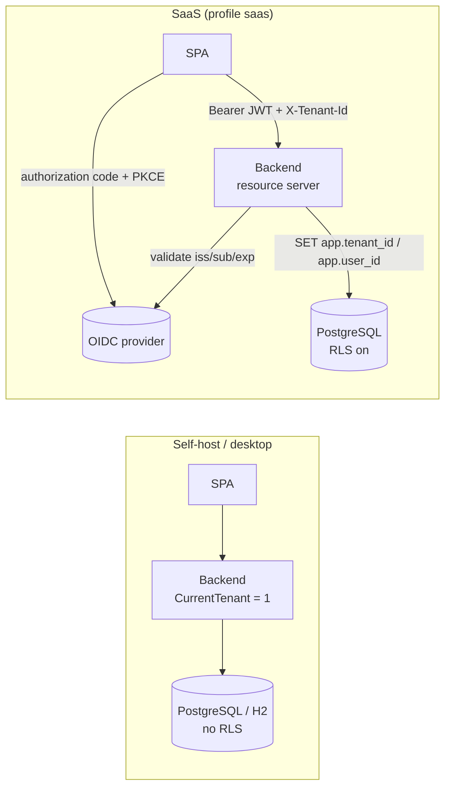

# Multi-tenancy and authentication (SaaS profile)

> **Status:** the design of the multi-tenant (SaaS) mode.
> **Audience:** contributors and maintainers.
> **Scope:** how one codebase serves a self-hosted single-company install and a
> multi-tenant SaaS, how tenants are isolated, and how users sign in through an
> identity provider (IdP) that can be exchanged later.
> For the schema and migrations as they are today see
> [`data-model.md`](./data-model.md) and [`backend.md`](./backend.md).

## Goals

- **Self-host stays small.** One instance, one company, no login of its own
  (a reverse proxy protects it, as today). No multi-tenancy code on its path.
- **SaaS serves many companies** from one deployment, with users that can belong
  to several companies (an accountant), roles, and later SSO and API access for
  tax-advisor integrations.
- **Everything stays open source**, including the SaaS code (AGPL-3.0). The
  boundary between the two is clean enough to split into a separate module later.
- **The IdP and the database host are replaceable.** The application speaks plain
  OIDC and plain PostgreSQL, nothing vendor-specific.

Non-goals for now: billing, a tenant-admin UI beyond the basics, SCIM, data
residency per tenant.

## Decisions

| # | Decision | Why |
|---|----------|-----|
| 1 | **Tenant isolation by `tenant_id` + PostgreSQL row-level security (RLS).** The app sets the active tenant per connection; repositories do not repeat `WHERE tenant_id = ...`. | Keeps the repositories (and therefore self-host) almost unchanged, and a forgotten filter cannot leak data: the database refuses. |
| 2 | **Self-host and desktop are "one tenant with id 1"**: `tenant_id` has the default `1`, there is no RLS, no tenant table, no login. H2 (desktop) has no `tenant_id` at all. | The multi-tenant machinery exists only where it is needed. |
| 3 | **A Maven profile `saas` + the Spring profile `saas`.** The Maven profile adds the dependencies (Spring Security, OAuth2 resource server) and the source/test/resource folders of the SaaS code; the Spring profile switches the behaviour on at run time. | The self-host JAR carries no SaaS libraries. The core never imports the SaaS package (it would not compile without the profile), which is the boundary. |
| 4 | **Authentication is OIDC only.** The backend is an OAuth2 resource server that validates JWTs from a configured issuer; the SPA signs in with the authorization-code flow with PKCE. The application stores **no passwords**. | SSO and a provider switch are configuration, not a rewrite. |
| 5 | **Start with a managed IdP, keep it exchangeable.** Authorization (tenants, roles) lives in our database, not in IdP claims. | See "Switching the IdP". |
| 6 | **The database host is "plain PostgreSQL".** No Supabase Auth, no PostgREST, no `auth.uid()`. | A move to any other PostgreSQL is a connection string. |

## Overview

## Data model

### Core schema (always present)

A Flyway migration adds `tenant_id INT NOT NULL DEFAULT 1` to every tenant-owned
table and moves the uniqueness rules to include it:

| Table | Change |
|-------|--------|
| `owner`, `customer`, `equipment`, `article`, `service`, `invoice`, `invoice_item`, `invoice_period`, `invoice_template`, `document_history`, `payment` | `tenant_id` column. |
| `document_number_series` | unique `(tenant_id, document_type_id, doc_year)`: number ranges are per company. |
| `user_settings` | primary key `(tenant_id, setting_key)`. |
| `invoice` | unique `document_number` becomes unique `(tenant_id, document_number)`. |
| `owner` | one row per tenant (unique `tenant_id`), replacing the global "primary" owner. |
| `document_type`, `document_status` | **global lookup tables**, no `tenant_id`, no RLS. |

Repositories keep their SQL: an `INSERT` takes the column default, reads and
updates are filtered by RLS (SaaS) or see the single tenant (self-host). Where SQL
relies on global uniqueness (`MERGE ... ON setting_key`, `UPDATE ... WHERE type = ?
AND year = ?`) it stays correct because RLS only exposes the active tenant's rows.

### SaaS schema (second Flyway history, profile `saas` only)

- `tenant (id, name, status, created_at)` and foreign keys from the tenant tables.
- `app_user (id uuid, email, display_name, created_at)`.
- `user_identity (issuer, subject, user_id)`: which IdP account is which user.
- `tenant_member (tenant_id, user_id, role)`: a user can belong to many tenants.
  Roles start with `OWNER`, `ADMIN`, `ACCOUNTANT`, `READER`; they are authorization
  data and live here, **not** in IdP claims.
- `api_token (tenant_id, ...)` is reserved for DATEV / tax-advisor access later; the
  membership model already allows service accounts.
- The RLS policies, one per tenant table:
  `USING (tenant_id = current_setting('app.tenant_id')::int)` and the same
  `WITH CHECK`; the column default becomes `current_setting('app.tenant_id')::int`.
  The one-argument form of `current_setting` raises an error when the setting is
  missing, so a request without a tenant **fails closed**.

The SaaS migrations use their **own history table** (`flyway_schema_history_saas`,
location `db/migration-saas`) and run after the core migrations. Sharing one
history would force the two folders to share one version sequence and break
validation as soon as a core migration is added after a SaaS one.

A test lists every table with a `tenant_id` column and fails if one lacks an RLS
policy, so a new table cannot be forgotten.

### Database roles

- **Migration role** (table owner): runs Flyway. It bypasses RLS and is never used
  by the running application.
- **Application role** (`NOSUPERUSER NOBYPASSRLS`, not the owner): the only role the
  backend connects with. If the application ran as the owner, RLS would be silently
  skipped. A test connects as the application role and proves tenant A cannot see
  tenant B's rows with plain SQL.

## Request flow (SaaS)

1. The SPA sends `Authorization: Bearer <JWT>` and the active tenant in
   `X-Tenant-Id`.
2. Spring Security validates signature, issuer, audience and expiry.
3. The backend maps `(iss, sub)` to an `app_user` through `user_identity`. An unknown
   identity creates the user on first sign-in (provisioning), without any tenant.
4. The backend checks **in the database** that the user is a member of the requested
   tenant and takes the role from `tenant_member`. A header naming a tenant the user
   is not in is rejected with 403. The tenant id is never taken from a request body.
5. A connection customizer sets `app.tenant_id` and `app.user_id` for the duration
   of the unit of work and clears them when the connection returns to the pool. The
   application's Hikari pool connects directly or through a session-level pooler.
   (Setting these on a connection behind a transaction-level pooler such as
   Supabase's port 6543 is not safe; migrations need a session connection anyway
   because Flyway and `SchemaMigrator` use session advisory locks.)
6. Controllers check the role for the operation (reader cannot write, only owners
   delete the tenant). RLS is the isolation guarantee, roles are the permission.

`document_history` gets `performed_by` from `app.user_id`; the document view shows the user's name (`ActorNames`, SaaS implementation `AppUserActorNames`). `tenant_audit` (`V6__tenant_audit.sql`, forced RLS) logs the team actions with the acting user through the same column defaults (`TenantAuditLog`, in the transaction of the change). The application role cannot update or delete either table's rows (`REVOKE`); `purge_tenant` removes `tenant_audit` with the tenant.

Background work that runs without a request (startup seeding, scheduled jobs) must
name its tenant explicitly. `TemplateBlocksBackfill` runs at startup only outside the SaaS
profile; in the SaaS profile default templates are created per tenant at provisioning.

## Switching the IdP

The application never stores the IdP's user ids outside `user_identity` and never
reads roles or tenants from claims. Only `iss`, `sub`, `email`, `email_verified` and
`name` are used. Switching from provider A to provider B is therefore a data
migration of one table, not an application change:

1. Configure B as an **additional accepted issuer** (the resource server accepts a
   list of issuers). Both A and B tokens work during the transition.
2. Create the users at B (export/import, or let them register again).
3. Link identities: for each user, insert a `user_identity (B-issuer, B-sub, user_id)`
   row. Matching is by **verified e-mail** (automatic) or by an invite link (manual,
   for addresses that changed). `tenant_member` is untouched.
4. Point the SPA at B, observe, then remove issuer A.

Consequences for the code: no provider SDK in the backend, no custom claims, no use of
provider-specific user ids. The e-mail must be verified before an identity is linked
to an existing user (otherwise someone could claim another account by registering the
same address).

### Choosing the first provider

The first provider is managed. Criteria to check before deciding (not decided here):
EU data processing and a data processing agreement; price per active user at the
expected size; OIDC conformance with PKCE and refresh tokens; enterprise SSO
(SAML/OIDC federation) and SCIM for later; organization support (not required, we keep
tenants ourselves); an open-source self-hostable counterpart so the later move to
self-hosting is a provider switch as described above.

## Maven and Spring profile `saas`

- `pom.xml` profile `saas`: dependencies `spring-boot-starter-security` and
  `spring-boot-starter-oauth2-resource-server`; `build-helper-maven-plugin` adds
  `src/saas/java`, `src/saas/resources` (including `db/migration-saas`) and
  `src/saas-test/java`.
- Core interface `CurrentTenant` (with `DefaultCurrentTenant` returning `1`) is what
  the core uses to know the tenant; the SaaS code provides the request-scoped
  implementation under `@Profile("saas")`.
- `SchemaMigrator` runs the core migrations, and the SaaS migrations when the SaaS
  location is on the classpath and the profile is active.
- CI: a second job builds and tests with `-Psaas` against PostgreSQL, in addition to
  the unchanged default jobs, so neither variant can break the other unnoticed.
- The self-host build (`mvn package` without `-Psaas`) must keep passing every test
  that exists today.

## Security notes

- **CSRF:** the API authenticates with a bearer token in the `Authorization`
  header, which a foreign site cannot attach, so classic CSRF does not apply as long as
  no cookie authenticates API calls. The SPA keeps the access token in memory (not
  `localStorage`) and renews it with the IdP; the trade-off is a refresh on page load.
  Security headers and CORS still apply.
- **Uploads:** `saas.storage.TenantFileStorage` keeps them under the key
  `<tenant id>/<file>` in an `ObjectStore`: a directory (`BILLERY_FILES_STORE=local`,
  default) or a private bucket of an S3-compatible store (`s3`: several backend
  instances without a shared disk). URLs are `/uploads/<tenant>/<file>?sig=<HMAC>`,
  served by `UploadController` after the signature check; the PDF renderer reads only
  the active tenant's files (`FileStorage.read`, bytes rather than a path, so both
  stores work). The signatures do not expire yet (threat model G5).
- **Information leaks:** error messages and 404 vs 403 must not reveal whether another
  tenant's id exists; the isolation tests check this.

## Testing

- **RLS tests (PostgreSQL, application role):** two tenants, every tenant table:
  tenant A cannot select, update, delete or insert into B's rows, and a missing
  `app.tenant_id` raises an error.
- **API isolation tests:** with tokens for two tenants, every endpoint is called with
  the other tenant's ids (read, write, delete, export, PDF, XRechnung, GoBD export,
  search); all answers are 404/403 and no body contains foreign data.
- **Role matrix (`SaasRoleMatrixTest`):** one tenant with an owner, an admin, an accountant and
  a reader; every endpoint is called with each of them. The table groups the endpoints into
  READ (all roles), WRITE (not the reader), TEAM (owner and admin: members, invitations) and
  OWNER_ONLY (close); an allowed role must not get 401/403, a denied one exactly 403. A guard
  fails for any endpoint that is in no group.
- **Membership tests:** a user in tenants A and B sees only the selected one; a user
  in neither gets 403.
- **IdP switch test:** two issuers, one `app_user` linked to both identities, both
  tokens reach the same data.
- Self-host regression: the existing suite passes unchanged without `-Psaas`.

## Open questions

1. **System templates.** The baseline seeds four templates with `tenant_id = 1`. In
   SaaS they must exist per tenant: copy at provisioning, or make them shared
   (`tenant_id IS NULL`, readable by all, never writable). Leaning to copy, because
   tenants edit templates.
2. **Tenant selection UX.** `X-Tenant-Id` for the API; the SPA needs a switcher and a
   default for users with one tenant.
3. **Token storage.** In-memory access token plus silent renewal (leaning) versus a
   backend-for-frontend with an HTTP-only session cookie (then CSRF protection is
   required after all).
4. **Deprovisioning and export.** Answered in
   [`../operations/saas-data-lifecycle.md`](../operations/saas-data-lifecycle.md): a closed tenant
   stays readable and exportable for an export window, then the operator purges it; the retention
   duty for issued invoices stays with the customer, whose archive is the GoBD export. The legal
   review of that policy is still open.
5. **First IdP.** See the criteria above.

## Work breakdown

| Step | Content | Depends on |
|------|---------|------------|
| 1 | Core: `tenant_id` + per-tenant uniqueness + `CurrentTenant`; self-host unchanged | - |
| 2 | Maven profile `saas`, second Flyway history, CI job, boundary check | 1 |
| 3 | RLS policies, application role, tenant on the connection, DB-level isolation tests | 1, 2 |
| 4 | OIDC resource server, `user_identity`, `tenant_member`, roles, tenant selection | 2, 3 |
| 5 | SPA: sign-in (PKCE), token handling, tenant switcher | 4 |
| 6 | Provisioning and onboarding: sign-up, invites, default templates, deprovisioning | 4 |
| 7 | Tenant-scoped file storage | 3, 4 |
| 8 | API isolation test suite and IdP-switch runbook/test | 4 |
