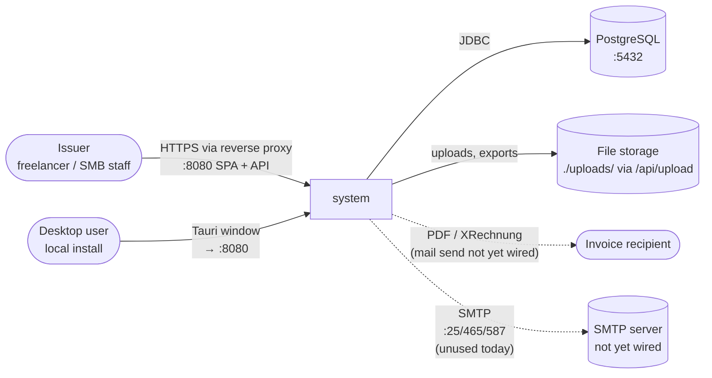
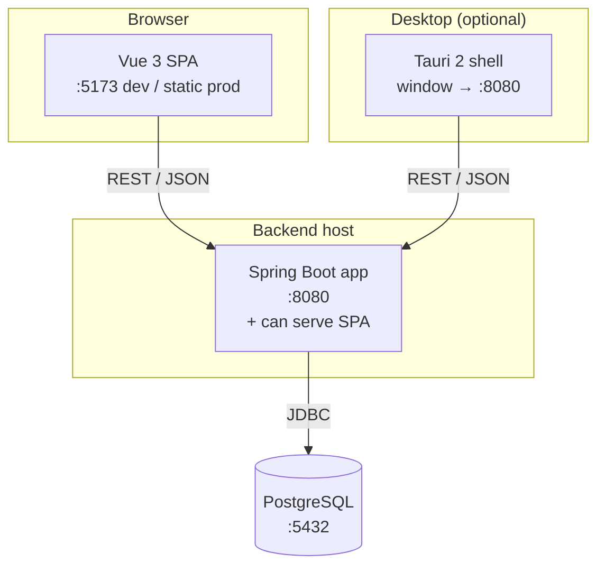
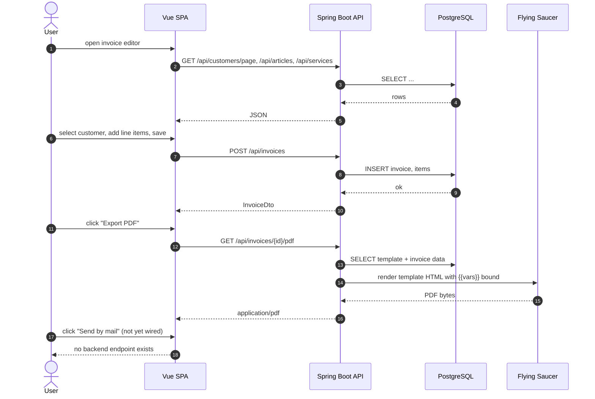

# Architecture Overview

> **Status:** first chapter of the `docs/architecture/` series.
> **Audience:** contributors and maintainers.
> **Scope:** what the system is, the technology stack, the deployable units, and the high-level data flow.
> For module-level detail, see the [document map](#document-map) at the bottom.

## What the system is

Billery is a self-hosted invoice management application for German
freelancers and small businesses. It manages customers, articles, services, and
the owner (the issuing company), and produces invoices, offers, cost
calculations, and final invoices from user-designed templates.

The defining feature is a **block-based template editor** in the web UI: the
user assembles a page out of typed blocks (header, address, invoice metadata,
line items, totals, payment, footer), configures each block, and the system
binds the blocks to live data via a `{{variable}}` substitution layer. The same
templates drive PDF output (HTML rendered by Flying Saucer) and XRechnung XML
output.

Three core user flows cover almost all day-to-day work:

1. **Issue an invoice** — pick a customer, add line items, save, export to PDF
   or XRechnung, optionally send by mail.
2. **Design or update a template** — drag blocks into a canvas, configure them,
   preview with sample data, persist to the database.
3. **Look up a record** — global search (`Cmd+K` / `Ctrl+K`) across customers,
   invoices, articles, and services.

## Primary users

| Role | What they do |
|------|--------------|
| **Issuer** (the user) | Issues invoices, manages customers and the catalog, designs templates. The web UI is built around this role. |
| **Recipient** | Receives the generated PDF or XRechnung by mail. Has no system access. |
| **Contributor** (developer) | Extends the system, fixes bugs, ships releases. Reads this doc. |
| **Operator** (self-hoster) | Deploys and maintains a running instance. Reads [`../operations/deployment.md`](../operations/deployment.md). |

## Technology stack

| Layer | Choice | Notes |
|-------|--------|-------|
| Backend language | Java 25 | Records, pattern matching, virtual threads available. |
| Backend framework | Spring Boot 4.1.0 | REST controllers, configuration, CORS. No JPA / Hibernate. |
| Database (server) | PostgreSQL 17 | Schema from the Flyway migrations in `db/migration/`; the whole backend suite also runs against it in CI (`POSTGRES_TEST_URL`). |
| Database (desktop, default tests) | H2 (`MODE=MariaDB`) | File database in the desktop app, in-memory for the tests (`src/test/resources/scheme-h2.sql`). |
| Data access | Spring `JdbcClient` | One `@Repository` per table writes its own SQL (named parameters) on the shared `JdbcClient` over a HikariCP pool (`DbConfig`). Transactions via an injected `TransactionTemplate`. No Spring Data, no JPA. |
| Migrations | Flyway (PostgreSQL), hand-rolled (H2) | `SchemaMigrator` applies `db/migration/V*.sql` on startup; `DatabaseMigration` runs idempotent deltas on H2 (desktop) only. |
| Configuration | `java-dotenv` | Loads `.env` from the JVM working directory at startup (`backend/.env` when running from that directory; `AppConfig.java:13`). Docker uses env vars directly. |
| PDF rendering | Flying Saucer (`xhtmlrenderer`) | HTML templates → PDF. |
| PDF alternative | OpenPDF | Available alongside Flying Saucer. |
| Document import/export | Apache POI 5.5.1, docx4j 11.5.14, ODF Toolkit 0.13.0 | DOCX/ODT round-trip via `DocumentConversionService` and `DocumentController`. |
| XRechnung | Custom generator in `xmlgenerator/` | German e-invoice format (XRechnung 3.0, UBL), `GET /api/invoices/{id}/xrechnung`. |
| XRechnung validator | KoSIT validationtool 1.5.0 (`scripts/fetch-kosit-validator.sh`) | Not part of the build; the `xrechnung` CI job validates generated invoices with it. |
| Mail | Simple Java Mail | `SmtpMailProvider` sends the SaaS invitation mails. Invoices cannot be sent by mail yet. |
| API docs | SpringDoc OpenAPI 3.0.3 | Swagger UI auto-mounted at `/swagger-ui.html`; OpenAPI JSON at `/v3/api-docs`. |
| Frontend language | JavaScript (no TypeScript) | Per `AGENTS.md`. |
| Frontend framework | Vue 3.5.27 | Composition API, single-file components. |
| Build tool | Vite ^8.0.0 | Dev server on `:5173`. |
| Router | Vue Router 5.0.0 | Intentional choice; do **not** downgrade to 4.x. The project pins `^5.0.0`. |
| HTTP client | axios | Base URL configurable via `VITE_API_BASE_URL`; falls back to `window.location.origin` when empty. |
| Drag-and-drop | Native HTML5 | The template editor uses native HTML5 DnD (`@dragstart` / `@drop` in `TemplateEditor.vue` and `BlockOutline.vue`). The `vuedraggable` dependency is declared in `package.json` but has zero imports. |
| Sanitisation | DOMPurify | Preview HTML is sanitised via `utils/sanitize.js`. |
| Desktop shell | Tauri 2 | `app-desktop/`. The Tauri window opens `http://127.0.0.1:8080` directly (the running backend), not the embedded SPA build. |
| Backend code style | Google Java Format 1.36.1 | Enforced by Spotless; the formatter version is pinned in `backend/pom.xml`, so a Spotless update does not reformat the code. |
| Backend static analysis | PMD via `maven-pmd-plugin` 3.28.0 | Custom ruleset at `backend/pmd-ruleset.xml` (imports `bestpractices`, `codestyle`, `errorprone` categories with rule exclusions). |
| Backend coverage | JaCoCo | Reported in CI; badge in `docs/badges/`. |
| Frontend test | Vitest ^4.1.5 | jsdom environment. |
| SAST | Semgrep | `semgrep scan --config auto --error` over the whole repo (`pr-sast.yml`). |
| LLM review | Hosted LLM | Advisory PR comment for verified commits of the maintainer only (`llm-review.yml`); not a merge gate. |
| Desktop installers | Tauri 2 + `scripts/build-desktop.sh` | Bundles the backend JAR (built with the `desktop` Maven profile, H2 at `compile` scope) and a jlink'd JRE. |
| Container | Docker Compose | Root `docker-compose.yml` (full stack) and `backend/docker-compose.yml` (DB only). |

## System context (C4 Level 1)

External actors and the systems the application talks to.

The system boundary is the union of the three deployable units described in
the next section. The SMTP edge is dashed because only the SaaS invitations use
`SmtpMailProvider`; the self-host build sends nothing.

## Container view (C4 Level 2)

Three deployable units compose the system. The web app and the Tauri shell are
alternative front-ends for the same backend. The backend can also host the
SPA itself (see `SpaWebConfig` in [`backend.md`](./backend.md)) — that is a
third deployment shape for the same binary.

## Deployable units

| Unit | Path | Build | Runtime | Configuration |
|------|------|-------|---------|---------------|
| **Backend** | `backend/` | `mvn clean install -DskipTests` | `mvn spring-boot:run` (dev) or `java -jar` (prod) on `:8080`. Can also host the built SPA via `SpaWebConfig`. | `backend/.env` (dev) or env vars (Docker) |
| **Web frontend** | `frontend/` | `npm run build` → `dist/` | Vite dev server `:5173` (dev) or static hosting (prod) | `VITE_API_BASE_URL` (no `.env` committed; falls back to `window.location.origin` in `src/services/baseService.js`) |
| **Desktop shell** | `app-desktop/` | `npx tauri build` (or `cargo tauri build`) | Native binary. The Tauri window points at `http://127.0.0.1:8080` (the bundled backend, started and stopped by `src/lib.rs`), not the embedded SPA build. `reqwest` (blocking) is used for the health check and the shutdown call. | Tauri config in `app-desktop/tauri.conf.json` |
| **Desktop runtime (Maven)** | `backend/` (`desktop` Maven profile + `spring.profiles.active=desktop`) | `mvn package -Pdesktop` | A self-contained JAR with H2 in `compile` scope (no database server needed). The Maven `desktop` profile only widens the H2 dependency scope; the CORS extension to `tauri://localhost` requires Spring's `desktop` profile via `application-desktop.properties`. | `application-desktop.properties`; CORS extended to `tauri://localhost` |

The full stack is started with `docker compose up` at the repository root; the
backend-only DB is in `backend/docker-compose.yml`.

## High-level data flow: issue an invoice

The sequence below traces the most representative end-to-end path. The
"send by mail" step is dashed because no endpoint mails a document yet;
`SmtpMailProvider` is only used for the SaaS invitations.

Two architectural properties to notice:

- **The template is data, not code.** It lives in the database as a JSON column
  and is bound to invoice data at render time. The PDF pipeline has no
  compile-time knowledge of any specific template.
- **The backend is the only thing that talks to the database.** No direct DB
  connection from the frontend, no shared schema knowledge between layers.

XRechnung is generated separately by `xmlgenerator/XRechnungGenerator` from
the invoice, its items and the seller / buyer data frozen at issue
(`PartySnapshot`). It does **not** read the block template — the XRechnung schema is rigid and the block
editor is HTML-only. PDF and XRechnung are independent outputs of the
same underlying data.

## Module map (one-line per package)

| Package | Responsibility |
|---------|----------------|
| `api/controller` | REST endpoints. 10 controllers: `ArticleController`, `CustomerController`, `DocumentController` (DOCX/ODT import + variable list/validation), `FileUploadController` (`/api/upload`), `HealthController`, `InvoiceController` (CRUD + PDF + number series), `InvoiceTemplateController`, `OwnerController`, `SearchController`, `ServiceController`. |
| `api/dto` | Wire-format objects. No entity leakage. |
| `service` | Cross-cutting business logic: `DocumentConversionService` (DOCX/ODT), `DocumentNumberService`, `DocumentService`, `FileSecurityService`, `TemplateBlocksBackfill` (default blocks for templates without any, on `@PostConstruct`). |
| `repository` | JDBC on Spring's `JdbcClient`. `BaseRepository` holds error translation (`run`, `databaseError`) and row helpers (`generatedId`, `decimalOrZero`), no generic CRUD; each of the 11 repositories (`Article`, `Customer`, `DocumentHistory`, `DocumentNumberSeries`, `Equipment`, `Invoice`, `InvoiceTemplate`, `Owner`, `Payment`, `Service`, `UserSettings`) writes its own SQL. They are `@Repository` beans injected by constructor. |
| `data` | Entity classes used between layers. Not JPA-managed. All entity classes are plain POJOs. |
| `pdf` | HTML → PDF (Flying Saucer) and the OpenPDF path. |
| `xmlgenerator` | XRechnung XML output. Note the lowercase package name. |
| `mail` | `MailProvider` interface, `SmtpMailProvider` (Simple Java Mail), `MailSettings`, `MailMessage`, `MailAttachment`. Used only by the SaaS invitations (`saas.provisioning.InvitationMailer`). |
| `document` | Strategy pattern dispatching on document type: `DocumentTypeStrategy` interface, `BaseDocumentTypeStrategy`, `DocumentStrategyRegistry`, plus `InvoiceStrategy`, `OfferStrategy`, `CostCalculationStrategy`, `PartedInvoiceStrategy`, `FinalInvoiceStrategy`. |
| `statistics` | Reporting aggregations (`InvoiceStatistics`, `InvoiceStatisticsService`). |
| `config` | `AppConfig` (paths from `.env`), `CorsConfig` (global CORS for `/api/**`), `SpaWebConfig` (serves the built SPA from `classpath:/static/`, fallback to `index.html`), `WebConfig` (serves `/uploads/**` from `./uploads/`). |
| `MainApp` | Entry point. Runs DB initialisation and migrations on startup. |

Each of these is unpacked in a dedicated chapter. See the
[document map](#document-map).

**Next:** [`backend.md`](./backend.md) — module boundaries, layering rules, the
custom JDBC repository pattern.
