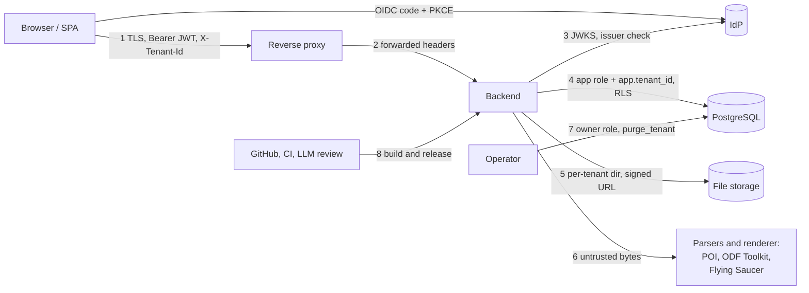

# Threat model

> **Status:** first version, derived from the architecture docs and `AGENTS.md`.
> Controls marked *in place* are described in those documents; they were not
> re-verified line by line when this page was written. Items under
> [Gaps](#gaps-and-open-questions) are findings, not decisions.
> **Audience:** maintainers and anyone (human or agent) changing security-relevant code.
> **Scope:** the finished SaaS is the reference. Self-host and desktop are
> derived from it by [removing](#reductions-self-host-and-desktop) what they do not have.
> Design background: [`multi-tenancy.md`](./multi-tenancy.md), [`backend.md`](./backend.md).

## How to use this page

- A change that touches a **trust boundary** (see below) or one of the **assets**
  needs a line in its PR: which threat ID it affects and how it was verified.
- Every threat points to a **control** and to the **check that enforces it**
  (test, CI job, or "none"). "None" is a gap, not an acceptable steady state.
- Review this page when a new endpoint, parser, upload path, background job,
  external service or deployment mode is added.

## Assets (what an attacker wants)

| ID | Asset | Why it matters |
|----|-------|----------------|
| A1 | **Tenant business data**: customers (personal data), invoices, payments, article prices, owner/bank data | Confidential; GDPR; invoices are tax records |
| A2 | **Integrity of issued documents**: numbers, frozen snapshots, payment history, `document_history` | GoBD: issued invoices must be unalterable and retained; a forged or altered invoice has legal and financial effect |
| A3 | **Tenant isolation** | One breach exposes every customer of the SaaS at once |
| A4 | **Identities and sessions**: OIDC tokens, `user_identity`, memberships and roles | Account takeover gives A1 and A2 of every tenant the user belongs to |
| A5 | **Availability** of the service | Invoices are due on deadlines; one tenant must not take down all |
| A6 | **Operator secrets and infrastructure**: DB credentials (owner vs app role), `BILLERY_FILES_SECRET`, `LLM_API_TOKEN`, CI | Owner credentials bypass RLS; CI secrets reach production |
| A7 | **The code and release pipeline** | A malicious change is shipped to every installation |
| A8 | **Uploaded files and generated documents** (logos, PDFs, XRechnung XML, GoBD ZIPs) | Cross-tenant file access; documents are legally relevant |

## Actors

| Actor | Capability assumed |
|-------|--------------------|
| **Anonymous internet user** | Reaches every open endpoint: `/api/health`, `/api/health/ready`, `/api/config`, static files, `/uploads/...` with a guessed URL |
| **Authenticated user of tenant A** | Valid token, member of A with some role. Wants B's data or higher privileges |
| **Malicious tenant** | Pays for an account and attacks the platform: resource exhaustion, template/parser abuse, isolation breaks |
| **Compromised or careless member** | Legitimate account used wrongly (stolen token, phished admin) |
| **Hostile website / third party** | Runs in the victim's browser: cross-site requests, framing |
| **Malicious input document** | A crafted DOCX/ODT, logo, template or JSON body, uploaded by an otherwise honest user |
| **Supply-chain attacker** | Malicious dependency, compromised GitHub Action, poisoned PR or issue text |
| **Insider / operator error** | Wrong migration, misconfigured proxy, leaked `.env`, owner credentials in the app |
| **Faulty automation** | A coding agent or bot that ships a change that is plausible but wrong (this has happened) |

Out of scope for now: a compromised IdP provider, a malicious cloud/database host,
nation-state attackers, physical access to a user's device.

## Trust boundaries

| # | Boundary | What crosses it | Main risk |
|---|----------|-----------------|-----------|
| 1 | Browser to proxy/backend | Requests, tokens, tenant header | Spoofed tenant, stolen token, XSS, CSRF (self-host only) |
| 2 | Proxy to backend | `X-Forwarded-*` | Spoofed host/scheme if the backend is reachable directly |
| 3 | Backend to IdP | JWKS, token validation | Token for another app/issuer accepted |
| 4 | Backend to database | SQL, tenant GUC | Isolation failure, owner role used by app |
| 5 | Backend to file storage | Uploads, file names | Path traversal, cross-tenant read |
| 6 | Backend to parsers/renderer | Untrusted bytes and template HTML | Decompression bombs, SSRF, file read, XXE, CPU/heap exhaustion |
| 7 | Operator to database | Owner role, runbooks | Over-privileged use, data loss |
| 8 | Repository to production | PRs, CI, releases, LLM review | Malicious or faulty change merged |

## Threats

Format: STRIDE category, then the control, then **what enforces it**.
Status: ✅ in place · ⚠️ partial · ❌ gap.

### Identity and access (A3, A4)

| ID | Threat | Control | Enforced by | Status |
|----|--------|---------|-------------|--------|
| T1 | **Tenant spoofing** (S/E): user sends `X-Tenant-Id` of a tenant they are not in | Membership checked in the database by `TenantContextFilter`; id never from a body | `SaasIsolationTest`, `TenantIsolationTest` | ✅ |
| T2 | **Cross-tenant read/write** (I/T): missing `WHERE`, IDOR with another tenant's id | Forced row-level security, fail-closed GUC, app role is neither owner nor `BYPASSRLS`, composite foreign keys | `TenantIsolationTest` (every `tenant_id` table has forced RLS), `SaasIsolationTest` (every endpoint listed, attacked with foreign ids) | ✅ |
| T3 | **App connects with an over-privileged role** (E): RLS silently skipped | Separate migration role (`DB_MIGRATION_USER`) and app role; documented | Startup assumptions, tests run as app role. No runtime assertion that the app role is not the owner | ⚠️ |
| T4 | **Token for the wrong audience or issuer** (S) | `TrustedIssuers` checks signature, expiry, issuer; audience is mandatory (the start fails without `billery.security.audience`) | `IdpSwitchTest` for issuers, `SaasApiTest` (wrong audience is 401), `TrustedIssuersTest` | ✅ |
| T5 | **Account takeover through IdP switch or unverified e-mail** (S) | Link only by **verified** e-mail; authorization data in own tables, not claims | `IdpSwitchTest`, `IdentityService` rules | ✅ |
| T6 | **Privilege escalation inside a tenant** (E): reader writes, admin makes itself owner | `Role.allows`, `MemberService` rules, last owner stays | `RoleTest`, `SaasApiTest`, and `SaasRoleMatrixTest`: every `/api` endpoint with owner, admin, accountant and reader, expectations in one table, unlisted endpoints fail | ✅ |
| T7 | **Invitation abuse** (S/E): accept an invitation meant for someone else | Invitation names an address; accepted only with that verified address; explicit tenant filter in queries | Service tests | ✅ |
| T8 | **Token theft from the browser** (I): XSS reads the token | Access token **in memory only**, never in storage; CSP; reviewed `v-html` uses | SAST (semgrep) on `v-html`. CSP; `frame-src` allows `blob:` for the PDF preview (`SecurityHeadersAndOriginFilterTest`, `e2e-smoke`); `style-src` keeps `'unsafe-inline'` | ⚠️ |
| T9 | **CSRF** (T): hostile site triggers a write | SaaS: bearer header, not cookies, so not exposed. **Self-host behind proxy basic auth: exposed** (browser caches the credentials) | Origin check (`SecurityHeadersAndOriginFilter`); the bearer exemption is open (G1) | ⚠️ |

### Data, documents and integrity (A1, A2, A8)

| ID | Threat | Control | Enforced by | Status |
|----|--------|---------|-------------|--------|
| T10 | **Altering an issued invoice** (T/R): edit after issue, delete, re-layout | `DocumentStateException` (409), PDF from frozen snapshot, append-only payments, history rows | Lifecycle tests | ✅ |
| T11 | **Number gaps or reuse** (T): failed save leaves a hole, concurrent issue duplicates | Number reserved inside the transaction, rolled back with it; unique per tenant | Service tests | ✅ |
| T12 | **Wrong amounts** (T): float errors, client-supplied totals | `BigDecimal` end to end, server recomputes, `VatCalculator` single source | Unit tests, KoSIT validation (`xrechnung` job) | ✅ |
| T13 | **Cross-tenant file access** (I): guess `/uploads/<tenant>/<name>` | Per-tenant directory, HMAC-signed URL checked before existence is revealed, renderer resolves only the active tenant's files | Unit tests for `UploadSigner`/`UploadController`. Signature never expires (G5) | ⚠️ |
| T14 | **Path traversal or file overwrite on upload** (T) | File names generated server side through `FileStorage` | `FileUploadControllerTest` | ✅ (verify names are never client-derived) |
| T15 | **Repudiation**: who changed or issued what | `document_history.performed_by` from `app.user_id`, shown by name; `tenant_audit` logs invitations, members, roles, sign-up and closing with the acting user; the application role may not change either (`REVOKE UPDATE`) | `TenantAuditTest`. **Not logged:** sign-ins, exports, operator actions in the database; not tamper-evident against the database owner | ⚠️ |
| T16 | **Data export leaks** (I): GoBD ZIP, per-tenant export | Same RLS path; read-only in closed tenants | `SaasIsolationTest` covers the endpoint | ✅ |

### Untrusted input and processing (A5, A8, boundary 6)

| ID | Threat | Control | Enforced by | Status |
|----|--------|---------|-------------|--------|
| T17 | **Decompression bomb** in DOCX/ODT import (D) | Limits on size, entries, expanded bytes, ratio, time (open) | Negative tests only; **no test that valid files still pass** | ⚠️ |
| T18 | **SSRF / local file read through the PDF renderer** (I): template HTML is user input | `RestrictedUserAgent`: only uploads, `data:` images and the classpath stylesheet, never the network or other files | Renderer tests. A regression test that a `file://` / `http://` reference is refused is worth keeping | ✅ / verify |
| T19 | **HTML/script injection through template variables** (T/I): customer name with markup | Escaping in both renderers (parity cases); Flying Saucer does not run script | `TemplateParityTest`, `templateParity.spec.js` | ✅ |
| T20 | **XXE / XML abuse** (I/D): XRechnung or imported XML | Generator writes XML (no parsing of untrusted XML); import goes through POI/ODF Toolkit | No explicit hardening or test of the parsers' XML features found (G7) | ⚠️ |
| T21 | **Resource exhaustion by one tenant** (D): large lists, big PDFs, many requests, template with huge tables | Per-tenant request rate and at most 2 concurrent PDF / preview / XRechnung / export / import requests (`RequestLimitFilter`, 429), 2 MB upload limit, batched list endpoints, server-side paged document list (max. 200 per page), bounded GoBD export | `RequestLimitsTest`, `RequestLimitFilterTest`. **Limits count per instance; no quotas on stored data, no PDF render time or size limit** (G4) | ⚠️ |
| T21b | **Mass sign-up and mail abuse** (D/S): many accounts create companies or send invitation mails once sign-up is open | 24-hour limits in the database (`DailyQuota`, `daily_quota`): companies owned per user, sign-ups per user / source IP / system, invitation mails per user / recipient / source IP / system; a refused request counts nothing; refusals counted in `billery_quota_refused_total` with the alerts `BilleryAbuseLimitReached` / `BilleryAbuseSuspected`. Account-level controls (verified e-mail, bot protection) are the identity provider's (`saas-identity-provider.md`) | `SignUpLimitsTest`, `InvitationMailQuotaTest`, `alerts.test.yml`. **The source IP is the first `X-Forwarded-For` address: only as good as the proxy that overwrites it (T24)** | ⚠️ |
| T22 | **Injection** (T/I): SQL via search, sort, filters | `JdbcClient` with named parameters; no string-built SQL by convention | Semgrep; no systematic test of search/sort parameters | ⚠️ |
| T23 | **Verbose errors leak internals** (I) | `ApiExceptionHandler` returns generic JSON; import errors generic | Tests per handler | ✅ |

### Infrastructure and operations (A5, A6)

| ID | Threat | Control | Enforced by | Status |
|----|--------|---------|-------------|--------|
| T24 | **Backend reachable without the proxy** (S): forged `X-Forwarded-*` | Docs say never expose the port; compose binds `127.0.0.1` | Documentation only | ⚠️ |
| T25 | **Default or leaked credentials** (E): dev passwords in production, `.env` committed | Fail-closed secret handling, gitleaks | `gitleaks` is a required check | ✅ |
| T26 | **Tenant purge deletes the wrong tenant** (T/D) | `purge_tenant` not granted to app role, refuses tenant 1; the procedure in `docs/operations/saas-data-lifecycle.md` selects by status and `closed_at`, has a check step and a purge register outside the database | `TenantPurgeTest`. Procedure is manual; the only way back is a restore of every tenant | ⚠️ |
| T27 | **Backups restore another tenant's data or lack encryption** (I) | `backup.sh` encrypts with age when `BACKUP_AGE_RECIPIENT` is set and refuses the off-site copy without it; a restore always replaces the whole database and all files, so it cannot put one tenant's rows into another (`docs/operations/backup-restore.md`). A restore brings purged tenants back; the purge register says which to purge again (`saas-data-lifecycle.md`) | `saas-stack.yml` backs up and restores the kit. **Encryption is optional for local backups; no per-tenant restore; purged data stays in backups until they expire** (G8) | ⚠️ |
| T28 | **Logs contain personal data or tokens** (I) | Rule: no passwords, tokens, document contents or e-mail addresses in logs; SMTP failures are logged as a redacted summary; retention 30 days / 5 × 10 MB (`docs/operations/ops-gotchas.md > Logging`) | The redaction of mail failures is tested. **The rule itself is a convention without an automated check** (G9) | ⚠️ |
| T29 | **Open endpoints abused**: `/api/config`, `/api/health`, `/api/health/ready`, `/api/me` | Minimal data; `/api` otherwise needs a token; `/v3`, Swagger and `/uploads` denied without signature | `SaasIsolationTest` lists endpoints | ✅ |

### Code, pipeline and automation (A7)

| ID | Threat | Control | Enforced by | Status |
|----|--------|---------|-------------|--------|
| T30 | **A change that breaks behaviour reaches `main`** (T/D) | CI jobs `build`, `postgres`, `saas`, `xrechnung`, frontend tests | **Only `SAST Security Checks` and `gitleaks` are required**; the test jobs are not. No approving review is required (G10) | ❌ |
| T31 | **Agent-written change that satisfies the checklist but breaks the product** | `AGENTS.md` verification rules | CI job `e2e-smoke` (`frontend/e2e/`) uses the packaged app in Chromium and fails on console errors, CSP violations and `/api` errors; it covers the main screens, the PDF preview and the document form's customer search only (G11) | ⚠️ |
| T32 | **Malicious dependency or workflow** | Dependabot (configured, weekly, grouped), Trivy dependency and image scan that fails on HIGH/CRITICAL with a fix (`security.yml`), the same gate before a release, SBOMs per release, the pushed image is the scanned one (build job read-only, `publish` the only write token), SAST | The new third-party action is pinned to a commit; the existing actions are still pinned by tag (accepted exclusion in semgrep). No signing or provenance of releases | ⚠️ |
| T33 | **Prompt injection through PR/issue text** into the LLM review | Review is advisory, runs only for the maintainer's verified commits, model has no tools | Workflow conditions | ✅ |
| T34 | **Issue text trusted as requirements** | Several issues were audit output ("I found no...") with P0/P1 labels and checklist criteria | Process only | ⚠️ G12 |

## Gaps and open questions

Ordered by risk, not by effort.

| ID | Gap | Why it matters | Suggested direction |
|----|-----|----------------|---------------------|
| **G10** | Test jobs are not required status checks; no review required | T30 is open for every change, not only for one change | Make `build`, `postgres`, `saas`, `xrechnung`, frontend tests required. Add a `CODEOWNERS` file (the rule requires code-owner review, but without the file it has no effect) |
| **G4** | Request limits count per instance; no quotas on stored data, no PDF render time or size limit | One tenant can still degrade everyone with few, expensive requests (T21) | A shared counter when there is more than one instance; timeouts on rendering; storage quotas with the tariffs |
| **G11** | End-to-end check of the built product covers only a smoke path | `e2e-smoke` runs the packaged app (SPA in the JAR) but not saving through the form, the lifecycle, import/export or the SaaS build | Extend `frontend/e2e/` with the core write flows; make `e2e-smoke` a required check |
| **G1** | The origin check rejects bearer clients without `Origin` (the blocked PDF preview, `frame-src` without `blob:`, is fixed) | API clients outside a browser cannot write | Decide the bearer exemption |
| **G6** | No trace of sign-ins, reads, exports or operator actions (`document_history` and `tenant_audit` cover writes to documents and to the team) | After an incident nobody can say who read or exported what (`docs/operations/saas-incident-response.md`, step 4) | Log exports and sign-ins in `tenant_audit`; an access log at the proxy with a retention period; the purge register covers purges |
| **G8, G9** | No per-tenant restore; purged data lives on in backups until they expire; log hygiene is a rule, not a check | One tenant's mistake cannot be undone without rolling back everyone; deletion takes effect with a delay (documented in `saas-data-lifecycle.md`) | Decide whether a per-tenant export / import is worth building; a test that scans the log output of the suite for addresses and tokens |
| **G5** | Upload signatures never expire | A leaked URL works forever | Accepted for now (URLs live in templates). The object store did not change it: the bucket stays private and every read still goes through the signature check; expiring URLs remain open |
| **G7** | XML parser hardening not evidenced | XXE / entity expansion | Test with an entity-bomb DOCX/ODT; configure the libraries |

## Reductions: self-host and desktop

Removing parts of the SaaS model changes which threats remain.

| Threat area | SaaS | Self-host | Desktop |
|-------------|------|-----------|---------|
| Identity (T4 to T8) | OIDC, roles | **No application login.** The proxy or network is the only barrier (T24 becomes critical). | None. Binds `127.0.0.1`, no network exposure intended |
| Tenant isolation (T1 to T3) | Core control | Not applicable (one tenant) | Not applicable |
| CSRF (T9) | Not exposed (bearer) | **Exposed** when browser-cached proxy credentials are used; needs origin check | Local webview; the shutdown endpoint has its own per-launch token |
| Multi-tenant abuse (T21) | Core threat | Reduced to "a user DoSes their own box" | Not relevant |
| Parsers and renderer (T17 to T20) | Hostile tenants | A trusted user importing a hostile file from outside (e.g. an e-mailed DOCX) | Same, local only |
| Data at rest (T27) | Operator | The owner of the installation | Local disk; no encryption by the app (the OS disk encryption is the control) |
| Supply chain (T30 to T33) | Production risk | Every installation pulls the same image or JAR | Installers are built by Tauri; a bad release reaches desktop users offline-update-free |

Desktop is "completely offline" today. The residual risks are the local port 8080
(another local process answering first, handled by `DESKTOP_INSTANCE_ID`), a
hostile document being imported, and the integrity of the installer.

## What this model suggests we test, check or require

These are consequences, not a plan. They are ordered the same way as the gaps.

1. **Gate (T30, G10):** required status checks for all test jobs; `CODEOWNERS`.
2. **Invariant tests, not bug tests (T1, T2, T6):** the `SaasIsolationTest` pattern
   (enumerate everything, fail on anything unlisted) now also covers roles
   (`SaasRoleMatrixTest`); response headers on every route are still open.
3. **Product smoke test on the built artifact (T31, G11):** started as the CI job
   `e2e-smoke` (`frontend/e2e/`); next are the core write flows.
4. **Fuzzing and property tests for parsers (T17, T20):** generate archives and XML
   instead of writing five by hand; include a positive corpus of real DOCX/ODT files.
5. **Abuse limits (T21):** a test that a render or import above the limit is refused.
6. **Startup assertions for misconfiguration (T3, T4):** the application refuses to start
   in SaaS mode if the audience is empty (done) or if the DB role is the table owner.
7. **A security note in each PR** naming the affected threat IDs and how they were verified.
