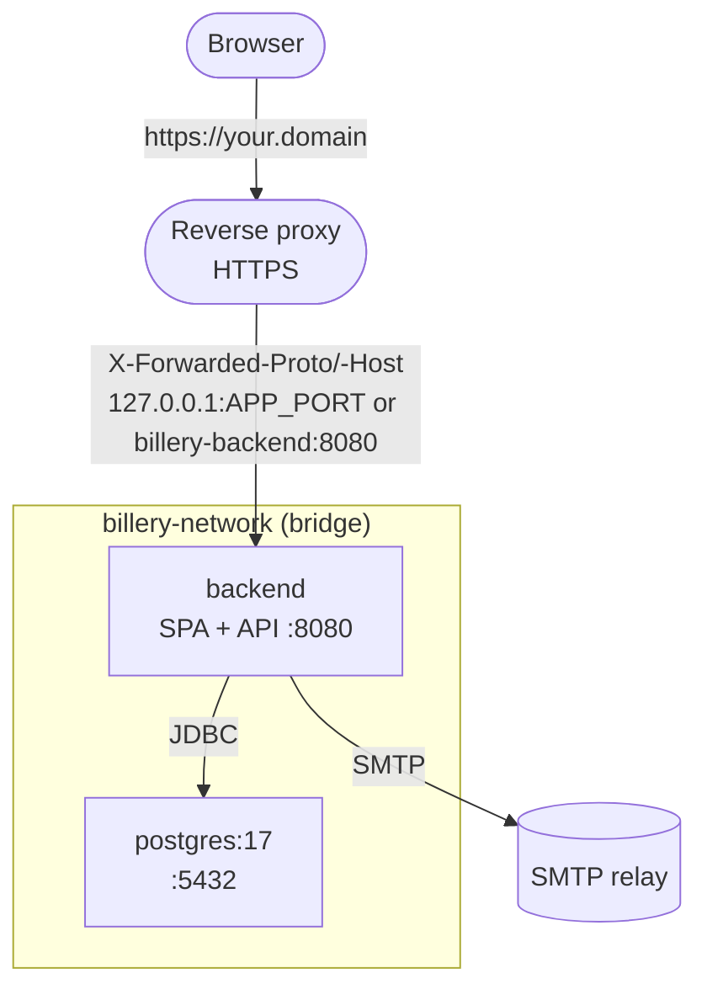

# Deployment

> **Audience:** operators and self-hosters.
> **Scope:** how the system runs in production — the Docker Compose
> topology, the two deployable shapes (multi-container and
> single-binary), local dev workflows, and where to find the env var
> reference.
> For environment variables see [`../reference/env-vars.md`](../reference/env-vars.md).
> For operational gotchas (mail, backups, logging, file uploads) see
> [`ops-gotchas.md`](./ops-gotchas.md). For CI see `.github/workflows/`.

## Deployable units

| Service | Image | Port | Container name |
|---------|-------|------|----------------|
| `postgres` | `postgres:17` (any PostgreSQL 15 or newer works, also an external one) | 5432 (not published) | `billery-db` |
| `backend` | built from `backend/Dockerfile` (multi-stage: Node builds the SPA, Maven builds the JAR with the SPA inside, Temurin JRE runs it) | 8080 | `billery-backend` |
| `frontend` (optional, profile `split`) | built from `frontend/Dockerfile` (Node 24, `serve`) | 5173 | `billery-frontend` |

The **backend image is the whole application**: it serves the SPA and the
API on one origin. The separate `frontend` service is only for setups that
want the SPA in its own container; it is not started by default.

Two `docker-compose.yml` files exist:

- `docker-compose.yml` at the **repo root** — full stack. Use this
  for a production-like local environment.
- `backend/docker-compose.yml` — PostgreSQL only. Use this
  when you want to run the backend with `mvn spring-boot:run`
  against a containerised DB.

## Quick start (Docker)

From the repo root:

```bash
cp .env.example .env
# Edit .env and set DB_PASSWORD to a new secret before starting Compose.
docker compose up --build
```

Compose exits immediately when `DB_PASSWORD` is missing or empty. The backend
fails during startup if it is set to a known development password. Supply it
through the deployment's secret manager as an environment variable, or use a
securely permissioned `.env` file for a self-hosted installation. This brings
up PostgreSQL and the backend. Once the backend healthcheck is
green, the app (SPA and API) is reachable at `http://localhost:8080`. It
is published on `127.0.0.1` only (`BIND_ADDRESS`). Self-host mode has **no
login of its own**. The SaaS build instead uses OIDC access tokens in the
`Authorization` header; the SPA keeps them in memory and does not use
cookie/session authentication.

To run a released image instead of building one, replace the `build:` block of the `backend` service
by `image: ghcr.io/billery-app/billery:<version>` (pin the version, or the digest from the GitHub release)
(if the package is private, `docker login ghcr.io` with a token that has `read:packages` first). The image is the
one that was scanned before the release ([`supply-chain.md`](./supply-chain.md)).

For a one-off build:

```bash
docker compose build
docker compose up
```

The data volume `postgres_data` is created on first run and persists
across container restarts. To start from scratch, remove the volume:

```bash
docker compose down -v
```

## Container topology



A few topology details that are easy to miss:

- **PostgreSQL runs `read_only: true`** with a tmpfs for `/tmp` and
  `/run/postgresql`. Data is still writable because the data directory
  is the `postgres_data` named volume, mounted at
  `/var/lib/postgresql/data`.
- **PostgreSQL's port is not published** by the root compose; the backend
  reaches it over the `billery-network`. Use
  `docker compose exec postgres psql -U billery billery` for
  direct access. (The dev compose in `backend/` does publish 5432.)
- **The backend container runs as the unprivileged user `app`** (UID/GID
  1001; the frontend image's `nodejs` user is 1001 as well) and keeps
  uploads in the `uploads` volume (`/app/uploads`). The image sets no
  `DB_USER` / `DB_PASSWORD`; pass them at runtime (the root compose does).
  The Dockerfile contains no database credential build arguments or image
  environment values; credentials are injected only when the container starts.
- **SPA and API share one origin.** The SPA calls the host it was
  loaded from (`VITE_API_BASE_URL` is empty by default and baked into
  the bundle at build time), so there is no CORS and no API URL to
  configure. Only a frontend on a different origin needs
  `VITE_API_BASE_URL` (rebuild) plus `CORS_ALLOWED_ORIGINS`.
- **Authentication model.** Self-host mode has no application login. SaaS
  mode uses OIDC bearer tokens in the `Authorization` header, not cookies or
  server sessions. Keep a self-host backend private and protect a public
  instance at the proxy (for example with Basic Auth, SSO, or a VPN).
- **Browser write protection.** Every `POST`, `PUT`, `PATCH`, and `DELETE`
  under `/api/**` must carry a same-origin `Origin` or `Referer`; missing,
  malformed, and cross-origin values are rejected with 403. A separately
  configured `CORS_ALLOWED_ORIGINS` entry is also trusted for a deliberately
  split SPA/API deployment. This prevents cross-site form and simple requests
  from using browser-cached proxy credentials. The desktop shutdown endpoint
  is separately protected by its per-launch token. If a future deployment
  introduces cookie/session authentication, add a server-validated CSRF token
  on unsafe methods as well; `SameSite` cookies or Origin checks alone are not
  a substitute for that token.
- **Response policy.** The backend sends a restrictive Content Security Policy
  (`script-src 'self'`, no `unsafe-eval`, `frame-ancestors 'none'`),
  `X-Content-Type-Options: nosniff`, and `X-Frame-Options: DENY`; only the SaaS sign-in
  callback `/auth/callback` may be framed by the same origin (`'self'` / `SAMEORIGIN`),
  for the silent token renewal. It adds
  `Strict-Transport-Security: max-age=31536000` only when the request is
  effectively HTTPS. The TLS-terminating proxy must overwrite client-supplied
  forwarding headers and send the actual `X-Forwarded-Proto`, `X-Forwarded-Host`,
  and `X-Forwarded-For` (the backend uses its first address as the client address,
  e.g. for the SaaS limits per source IP); expose the backend only to that trusted proxy. Caddy
  does this automatically. For nginx, configure these headers as in the
  example below. TLS termination, certificate renewal, and redirecting public
  HTTP to HTTPS remain the proxy/operator's responsibility.

## Behind a reverse proxy

Goal: HTTPS on your domain, a few `.env` values, no code or build
changes. The proxy forwards **everything** (`/`, `/api`, `/uploads`) to
the backend; there is nothing to configure for CORS.

1. Set runtime secrets in the secret manager or in `.env` next to
   `docker-compose.yml` (see [`.env.example`](../../.env.example)):
   ```env
   DB_PASSWORD=<secret-manager-injected-value>
   BIND_ADDRESS=127.0.0.1     # proxy on the same host connects to 127.0.0.1:APP_PORT
   APP_PORT=8080
   CORS_ALLOWED_ORIGINS=      # leave empty
   ```
2. `docker compose up -d --build`
3. Point the proxy at the backend:
   - **Caddy on the same host** (`deploy/Caddyfile.example`):
     ```
     demo.example.com {
         reverse_proxy 127.0.0.1:8080
     }
     ```
   - **Caddy / any proxy as a container**: join it to the compose
     network (`<project>_billery-network`, see `docker network ls`)
     and use `reverse_proxy billery-backend:8080`. The `ports:` mapping
     is then not needed.
   - **nginx** — it does not send the forwarded headers on its own:
     ```nginx
     server {
         listen 443 ssl;
         server_name demo.example.com;
         client_max_body_size 5m;                      # logo uploads (backend limit: 2 MB)
         location / {
             proxy_pass http://127.0.0.1:8080;
             proxy_set_header Host $host;
             proxy_set_header X-Forwarded-Proto $scheme;
             proxy_set_header X-Forwarded-Host $host;
             proxy_set_header X-Forwarded-For $remote_addr;   # overwrite, never append: the backend reads the first address
         }
     }
     ```
4. Protect the self-host instance (it has no application login), e.g. Caddy
   `basic_auth`. Unsafe browser API requests additionally need a trusted
   `Origin` or `Referer`; the backend rejects cross-site and origin-less
   writes even when a browser automatically supplies proxy credentials.

### Database credential rotation

`DB_PASSWORD` is supplied to both PostgreSQL's initial setup and the backend
at runtime. PostgreSQL reads `POSTGRES_PASSWORD` only when its data directory
is initialized; changing the environment variable alone does not rotate the
password in an existing volume.

To rotate the application role password:

1. Open an interactive PostgreSQL session with an authorized administrator:
   `docker compose exec -it postgres psql -U billery -d postgres`.
2. At the `psql` prompt, run `\password billery` (or the configured
   application role). Enter the new password at the hidden prompts; do not
   put it in a SQL command, shell argument, ticket, or log.
3. Update `DB_PASSWORD` in the deployment secret manager (or the protected
   `.env` file), then recreate the backend so it receives the rotated value:
   `docker compose up -d --force-recreate backend`.
4. Verify the backend health endpoint and database connectivity without
   printing the secret, then remove the old value from the deployment secret
   store.

For the SaaS two-role setup, rotate `DB_PASSWORD` for the application login
and `DB_MIGRATION_PASSWORD` for the migration role separately, updating each
role through the same hidden `psql` password prompt. Restart the backend
after changing the runtime secrets. Application startup and database
connection errors do not log credential values; avoid diagnostic commands
that print rendered Compose configuration or container environment values.

Why `X-Forwarded-Proto` / `-Host` matter: the proxy terminates TLS, so
the backend sees `http://backend:8080/...` while the browser sends
`Origin: https://demo.example.com`. Spring then treats the app's *own*
requests as cross-origin and answers **403 "Invalid CORS request"**
(and logo uploads would get `http://` URLs). Origin validation and HSTS also
need the effective public origin and HTTPS state. The backend therefore runs
with `server.forward-headers-strategy=framework`, which trusts these
headers: configure the proxy to replace incoming forwarded headers, and never
expose the backend port directly to the internet.

### Troubleshooting

| Symptom | Cause / fix |
|---------|-------------|
| Browser asks for "local network access", requests go to `localhost:8080`, "Network Error" | An old frontend bundle with `http://localhost:8080` baked in. Rebuild (`docker compose build --no-cache`); the default is now empty (same origin). |
| 403 on every request, `Invalid CORS request` in the backend log | The proxy does not send `X-Forwarded-Proto`/`-Host`, or the app is called through a different host name than the one the proxy forwards. |
| 403 only from another site/subdomain | That origin is not in `CORS_ALLOWED_ORIGINS` (only for a split frontend). |
| 403 on a write request | The browser did not send a same-origin `Origin` or `Referer`, the origin differs, or the reverse proxy forwarded the wrong public host/scheme. |
| HSTS missing | The request reached Spring as HTTP; verify the TLS proxy sends `X-Forwarded-Proto: https` and that the backend is only reachable through that proxy. |
| Upload fails with 413 | nginx `client_max_body_size` (default 1 MB); the backend allows 2 MB. |
| Logos broke after changing the domain | Uploaded logos store their absolute URL (`https://<host>/uploads/…`); the PDF still works (it only uses the file name), re-upload the logo for the browser view. |
| Mixed content warnings | Something calls `http://` on an https page: check `VITE_API_BASE_URL` is empty. |

## SaaS database roles

Only for a deployment with the Spring profile `saas` (JAR built with `mvn -Psaas`). Row-level
security is only a guarantee if the backend does **not** connect as the table owner, a superuser
or a role with `BYPASSRLS`; PostgreSQL skips the policies for those. Use two accounts:

| Account | Used by | Needs |
|---------|---------|-------|
| Migration role (`DB_MIGRATION_USER` / `DB_MIGRATION_PASSWORD`) | Flyway, once at start | owns the tables; may create roles (`V2__tenant_isolation.sql` creates `billery_app`) |
| Application login (`DB_USER` / `DB_PASSWORD`) | the running backend | a plain login role that is a **member of `billery_app`**, no superuser, no `BYPASSRLS` |

The kit in [`deploy/saas/`](../../deploy/saas/) creates all of it for you ([`saas-deployment.md`](./saas-deployment.md)):
`postgres/init/10-roles.sh` creates the roles before the first start, which works because the migration only
creates `billery_app` if it does not exist. To set it up by hand instead, create the login once, with the
migration role (after the first start has created `billery_app`):

```sql
CREATE ROLE billery_login LOGIN PASSWORD '...' IN ROLE billery_app;
```

The role gets `SELECT/INSERT/UPDATE/DELETE` on all tables (also on tables added later), read-only
access to `document_type` / `document_status` and no access to Flyway's history tables. Set
`DB_USER=billery_login`. The backend lends every connection the tenant of the request
(`app.tenant_id`); connect **directly or through a session-level pooler**, not through a
transaction-level pooler (Supabase's port 6543), because the setting lives in the session.
The migration account needs a session connection for the same reason (Flyway and the
migration lock use session advisory locks).

## Single-binary deploy

The backend can serve the built frontend as static resources (see
`SpaWebConfig` in
[`../architecture/backend.md`](../architecture/backend.md)). The
flow is:

1. Build the frontend: `npm run build` in
   `frontend/`. The output is in `dist/`.
2. Copy `dist/` into `backend/src/main/resources/static/`.
3. Build the backend: `mvn clean install -DskipTests` in
   `backend/`. The resulting `target/*.jar` is a Spring
   Boot fat JAR.
4. Run: `java -Djava.awt.headless=true -jar app.jar`. The
   `-Djava.awt.headless=true` flag (set in the Dockerfile)
   prevents AWT from trying to open a display. None of the
   runtime libraries (Spring Boot, Flying Saucer, OpenPDF) require
   a display.
5. Reach the app at `http://<host>:8080`. The API is under
   `http://<host>:8080/api/*`; the SPA is served from `/` and
   falls back to `index.html` for any non-`/api` path.

`VITE_API_BASE_URL` stays empty (the default) so the frontend uses
`window.location.origin` and the API is on the same host. This is
exactly what the Docker image does for you (`backend/Dockerfile`
builds the SPA into `static/`).

## Local development

### Backend (with Dockerised DB)

```bash
# from backend/
docker compose up -d            # starts PostgreSQL
SPRING_PROFILES_ACTIVE=dev mvn spring-boot:run  # backend on :8080
```

### Backend (with local PostgreSQL)

```bash
# from the repo root
SPRING_PROFILES_ACTIVE=dev mvn spring-boot:run -pl backend
```

For local development, activate the explicit `dev` profile to enable local
database defaults. Export it when starting the backend (profiles in
`backend/.env` are not used to select Spring profiles):

```bash
export SPRING_PROFILES_ACTIVE=dev
```

An optional `backend/.env` may then set the connection details:

```env
DB_HOST=localhost
DB_PORT=5432
DB_NAME=billery
DB_USER=billery
```

The development profile uses `billery` / `billery123` only when explicit
credentials are absent. Production and the root Compose stack require an
explicit non-default `DB_USER` / `DB_PASSWORD`. `Database.java` reads runtime
environment variables and the optional local `.env` file. See
[`../reference/env-vars.md`](../reference/env-vars.md) for the full
list.

### Frontend (against a running backend)

```bash
# from frontend/
npm install
npm run dev                     # dev server on :5173
```

The Vite dev server proxies `/api` to `http://localhost:8080`
(`vite.config.js`), so the SPA calls its own origin and needs no CORS or
`VITE_API_BASE_URL`. For a backend on a different host change the proxy
target.

## Native installers

Desktop installers are built with Tauri via
`scripts/build-desktop.sh` / `build-desktop.ps1` (frontend build →
backend JAR with the `desktop` Maven profile, which puts H2 on the
compile classpath → jlink'd JRE → `npx tauri build`). The
`jpackage-maven-plugin` profiles in `pom.xml` are stale and do not
produce a working installer.

## Where to go next

- Environment variables — [`../reference/env-vars.md`](../reference/env-vars.md)
- Operational gotchas — [`ops-gotchas.md`](./ops-gotchas.md)
- Development commands — [`../../AGENTS.md`](../../AGENTS.md)
